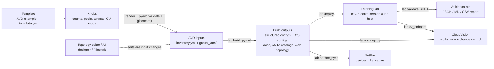
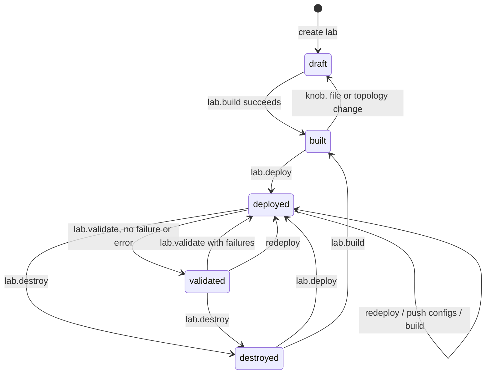

# 1. Concepts — the mental model

This chapter explains how avdlab thinks about a lab. If you know Arista AVD from the Ansible collection, most of it
will feel familiar: avdlab is AVD plus containerlab plus ANTA, driven from a browser, with every action recorded.

## 1.1 One rule: the AVD inputs are the source of truth

A lab in avdlab is an **AVD inventory**: `inventory.yml` plus `group_vars/` in the standard AVD layout, inside a git
repository on the orchestrator (`/data/labs/<slug>/`). Nothing else is authoritative.

- avdlab never invents its own network model. Configs, the containerlab topology, the ANTA inventory and catalogs,
  NetBox objects and CloudVision tags are all **derived** from AVD's outputs (structured configs, fabric topology
  CSV, metadata).
- Every way of changing a lab — the knob form, the file editor, the topology editor, the AI designer, a hot-added test
  host — ends up as a change of those inputs, validated with `pyavd.validate_inputs`, and as a **git commit** of the
  lab repository. You can see and diff every revision on the Build tab.
- Because it is a normal AVD directory, the same lab can be opened in VS Code (Git & VS Code tab), exported as a zip,
  pushed to a git remote or cloned back in, and built with `ansible-playbook` outside avdlab.

The AI designer follows the same rule strictly: the model can only propose knob values and topology operations; it
never writes YAML (chapter 6).

## 1.2 The pipeline

The stations, in the order the Getting started page presents them:

| Station | What happens | Where in the UI | Job |
|---|---|---|---|
| 1. Host | A Linux machine with Docker reached over SSH is probed and bootstrapped (Docker, containerlab, sysctls, agent image). | Hosts | `host.probe`, `host.bootstrap`, `host.verify` |
| 2. Image | A cEOS-lab version is downloaded from arista.com (your token) or uploaded, and pushed to hosts. | Images | `image.download`, `image.push` |
| 3. Lab | A template plus knob values becomes AVD inputs in a git repo. Nothing runs yet. | Labs → New lab | — (inline API call) |
| 4. Build | pyavd produces structured configs, EOS CLI configs, device and fabric documentation, ANTA catalogs, and avdlab turns the fabric topology CSV into `clab/topology.clab.yml`. | Lab header *Build*, Build tab | `lab.build` |
| 5. Deploy | The lab directory is copied to the host, containerlab starts the cEOS nodes with their intended config as startup-config, avdlab waits for eAPI. | Lab header *Deploy*, Runtime tab | `lab.deploy` |
| 6. Validate | ANTA runs the catalog AVD generated for this fabric (BGP, MLAG, VXLAN, interfaces, …) from the agent container on the lab's management network. | Lab header *Validate*, Validation tab | `lab.validate` |
| 7. CloudVision | The switches are onboarded (TerminAttr + onboarding token) and the configs and tags are pushed as a CloudVision workspace with `arista.avd.cv_deploy`. | CloudVision page, lab CloudVision tab | `lab.cv_onboard`, `lab.cv_deploy` |

Optional side branches: NetBox sync (`lab.netbox_sync`), Arista Cloud Test as a second execution target, clients and
traffic, MSS segmentation (foundation), ZTP provisioning.

## 1.3 Templates and knobs

A **template** is an AVD 6.4 example (inventory, group_vars, playbooks) plus a descriptor `template.yml` that lists
the **knobs** the UI exposes. Shipped templates:

| Template | Generator | What it is |
|---|---|---|
| `single-dc-l3ls` | `l3ls` | eBGP underlay + EVPN/VXLAN overlay, MLAG leaf pairs, L2 leafs; **fully generated** from counts, pools, ASNs, tenants and servers. The default first lab. |
| `dual-dc-l3ls` | `static` | two L3LS fabrics joined by EVPN gateways |
| `single-dc-multipod-l3ls` | `static` | five-stage Clos with super-spines and two pods |
| `l2ls-fabric` | `static` | layer-2 leaf-spine, MLAG spines as gateways |
| `campus-fabric` | `static` | campus L2LS with IDFs, `network_ports`, 802.1X port profile |
| `cv-pathfinder` | `static` | CV Pathfinder WAN (control plane only on cEOS) |
| `isis-ldp-ipvpn` | `static` | MPLS core: IS-IS + LDP, VPN-IPv4, PE/P/RR |
| `single-dc-l3ls-ipv6` | `static` | IPv6 underlay, optional dual-stack management (`mgmt_ipv6_subnet`) |
| `custom` | `none` | your own AVD inventory, imported from an archive or git |

The **generator** decides what knobs can do:

- `l3ls` — the whole inventory and group_vars for the node types are generated from the knobs (counts, pools, ASNs,
  serial scheme, tenants, servers). Changing `leaf_pairs` really adds leaf pairs.
- `static` — the example's group_vars are loaded as they are; knobs apply **targeted edits** (management subnet and
  gateway re-based, device password, serial numbers, platform, DNS, CloudVision, …). For anything else you edit
  group_vars in the Files tab.
- `none` (`custom`) — the files are the source of truth; knobs only shape the containerlab topology (image,
  architecture, client image, device tags, provisioning, segmentation, ACT).

Knob types are `int`, `string`, `cidr`, `ipv4`, `pool` (AVD pool syntax, validated), `secret` (stored encrypted,
returned masked), `object`, `yaml` and `bool`. Every knob has help text and a `learn` block (summary, AVD keys it
renders, pitfalls, doc link) shown as (i) popovers in learning mode.

**Saving knobs re-renders the inputs.** For generated and static templates, a knob save rewrites the knob-managed
files (`inventory.yml`, `group_vars/`). Hand edits in those files mark the related knobs as *custom*, but the next knob
save replaces them (the topology editor warns about this). Topology edits on generated labs are stored as
`topology_overrides` in the lab settings and re-applied after every knob render, so they survive.

## 1.4 The objects

| Object | What it is | Stored in |
|---|---|---|
| **Host** | A lab host: SSH address, user, port, optional jump host, platform (linux / mac / windows), credentials (references to secrets), kind `linux` (containerlab host) or `act` (ACT tools server), and the capabilities document of the last probe. | `hosts` table; host keys in `/data/known_hosts` |
| **Image** | A cEOS-lab image: format (`cEOS`, `cEOS64`, `cEOSarm`), version, docker tag (`arista/ceos:<v>` or `arista/ceos:<v>-arm64`), architecture, local tarball, which hosts have it. | `images` table, `/data/images/` |
| **Lab** | One AVD fabric: template, knob values, state, target (`clab` or `act`), host, cEOS version, optional CloudVision and NetBox target bindings. | `labs` table + git repo `/data/labs/<slug>/` |
| **Job** | One run of an action with parameters, status, result, artefacts and a log file. | `jobs` table + `/data/jobs/<id>/log.txt` |
| **Secret** | An encrypted value: SSH key, password, arista.com token, CloudVision token, NetBox token, generic (GitHub token, SMTP password, AI keys). Values are never returned by the API. | `secrets` table (Fernet ciphertext) |
| **CloudVision target** | A CVaaS tenant or on-prem cluster with a service-account token, optional onboarding token and ZTP script. | `cv_targets` |
| **NetBox target** | A NetBox URL with a write-only API token. | `netbox_targets` |
| **Validation run** | One ANTA run of a lab: totals and the reports. | `validation_runs` + `anta/runs/<id>/` in the lab repo |

### Lab states

| State | Meaning | Header buttons enabled |
|---|---|---|
| `draft` | inputs exist; intended configs missing or stale | Build |
| `built` | build outputs match the inputs | Build, Deploy |
| `deployed` | containers were started (or the last validation had failures/errors) | Build, Validate, Destroy (Deploy becomes *Redeploy* on the Runtime tab) |
| `validated` | the last ANTA run had no failure and no error | Build, Validate, Destroy |
| `destroyed` | containerlab destroyed the topology | Build, Deploy |

Notes: building a running lab does not change its state — the Runtime and Build tabs then offer **Push config changes**
for the switches whose intended config changed. Changing the lab target (`clab` ↔ `act`) is refused while the lab
runs and resets a built lab to `draft`. A lab can be deleted only when it is not running.

### Targets

| Target | Execution | Notes |
|---|---|---|
| `clab` (default) | containerlab on a Linux lab host over SSH | everything in this documentation unless stated otherwise |
| `act` | Arista Cloud Test: the build runs pyavd in digital-twin mode and writes an ACT topology YAML (with a tools server and client nodes) that you upload in act.arista.com; deploy pushes configs from the ACT tools server (a host of kind `act`) over eAPI | no containerlab, no incremental push, no traffic/snapshot jobs |

## 1.5 Jobs

Everything that takes longer than a page load is a **job**: the API answers `202 {job_id}` immediately and the job runs
as an asyncio task in the API process. Its log is written to `/data/jobs/<id>/log.txt` and streamed to the browser over
a WebSocket; the **job drawer** opens automatically when you start one. Jobs can be killed (the task is cancelled and its
SSH sessions are closed, so remote commands die too). Most lab actions refuse to start while a conflicting job of the
same lab is running (HTTP 409 naming the running job).

Short read-only actions run **inline** with a time budget instead (lab status 20 s, running config 25 s, CloudVision and
NetBox connection tests 15 s, ZTP status 15 s).

## 1.6 Where things run

| Runs on the orchestrator (API container) | Runs on the lab host |
|---|---|
| knob rendering, pyavd validation, **build** | containerlab, the cEOS containers |
| the git repositories of all labs | a copy of the lab directory in `/opt/avdlab/labs/<slug>/` (`AVDLAB_REMOTE_ROOT`) |
| the database, secret store, job logs | the **agent container** (`AVDLAB_AGENT_IMAGE`): ansible, pyavd, ANTA — used for validate, cv_deploy, config pushes |
| NetBox sync (pynetbox), AI designer calls, e-mail | the ANTA 1.10 image for PSIRT scans, the linux client containers, the `ztp` node |

The switches' management network exists only on the lab host. avdlab never talks eAPI to a switch from the
orchestrator: eAPI checks run as `curl` on the host, ANTA and Ansible run in containers attached to the containerlab
management network. That is why a lab host in the cloud, on the LAN or in a VM on a laptop all behave the same.

## 1.7 Beginner and advanced mode

The top bar has a **Beginner / Advanced** toggle (remembered per browser, default *Beginner*).

| | Beginner | Advanced |
|---|---|---|
| Navigation | hides NetBox, Devcontainer, Jobs | everything |
| Lab tabs | hides MSS, NetBox, ACT, Git & VS Code (a *Show advanced* link at the end of the tab row switches mode) | all tabs (ACT only for target `act`) |
| Hints | one-line hints on Hosts, Images, Labs, New lab and the Build / Topology / Validation tabs | hidden |
| Dashboard | welcome banner, intro video, tiles, next steps | adds hosts, labs and recent-jobs tables |

Hidden pages stay reachable by URL; beginner mode only declutters. Separately, **learning mode** (switch at the bottom of
the sidebar) adds knob help popovers, click-to-explain on config viewers and glossary hover cards.

## 1.8 Users and roles

avdlab has individual accounts with three roles, enforced by the backend on every `/api/*` request:

| Role | May |
|---|---|
| `viewer` | read everything (all GET), follow live job logs; change their own password and MFA. No web terminals, no changes. |
| `operator` | everything except user administration (`/api/users`), admin settings (`/api/admin`) and deleting hosts |
| `admin` | everything |

A refused call answers `403 {"detail": "role viewer may not POST /api/labs"}`. Passwords follow a policy (≥ 12
characters, 3 of 4 character classes, no username, not a common password), are stored as argon2id hashes, and accounts
lock after 5 failed sign-ins for 15 minutes. TOTP MFA with recovery codes is optional per user. Public account requests
can be enabled; an admin approves them with a role. Details: chapter 2 §(f) and chapter 5 (Account, Users).

## 1.9 Vocabulary

| Term | Meaning in avdlab |
|---|---|
| AVD | Arista Validated Designs; here the `pyavd` 6.4 Python package (eos_designs + eos_cli_config_gen) |
| eos_designs inputs | the fabric data model in `group_vars/` (node types, pools, tenants, connected endpoints) |
| structured config | the per-device data AVD derives from the inputs (`intended/structured_configs/<host>.yml`) |
| intended config | the EOS CLI rendered from the structured config (`intended/configs/<host>.cfg`) |
| cEOS-lab | containerised EOS; one container per switch |
| containerlab (clab) | the tool that wires cEOS containers with veth links from `clab/topology.clab.yml` |
| ANTA | Arista Network Test Automation; the test framework that validates the running fabric |
| agent image | the container image avdlab runs on the lab host for Ansible/ANTA work (default: AVD universal image) |
| TerminAttr | the EOS streaming agent that connects a switch to CloudVision |
| cv_deploy | the `arista.avd.cv_deploy` role that pushes configs and tags into a CloudVision workspace |
| knob | a template parameter exposed in the UI; writes AVD inputs |
| connected endpoint | a server/firewall/… attached to leaf ports in AVD; becomes a linux client container in the lab |
| test host | a linux client hot-added to a running lab on a free switch port |
