# 2. Architecture

avdlab is one container (the **api**: FastAPI + the built React SPA) plus whatever it reaches over the network: lab
hosts over SSH, and optional CloudVision, NetBox, an AI provider, an SMTP server and GitHub. This chapter shows the
pieces, how they are deployed, how a lab moves through them, and how credentials are protected.

## (a) Components

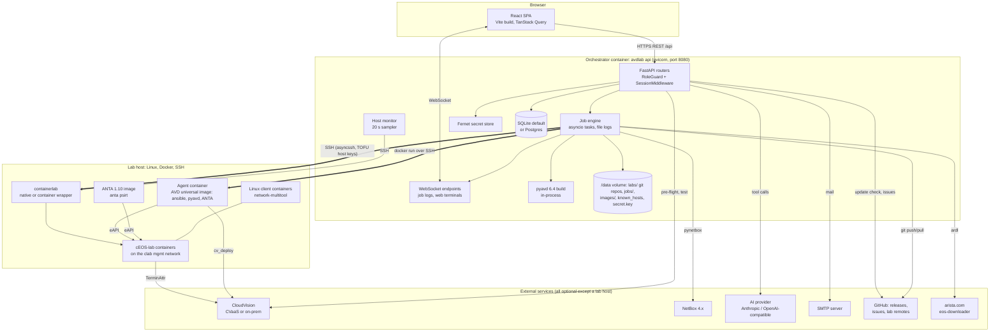


**Browser.** The SPA (React 18, TypeScript, Tailwind, TanStack Query, React Flow for the topology, xterm.js for
terminals, CodeMirror for YAML) is built into `frontend/dist` and served by the same API process. Any path that is not
`/api/...` and not a real file returns `index.html`, so deep links and page refreshes work.

**API.** One uvicorn process runs the FastAPI app (`backend/avdlab/main.py`). Routers are imported from a list of
feature modules (`FEATURE_MODULES`), each registering its own routes and job types. Middleware, from outside in:
`ProxyHeadersMiddleware` (only when `AVDLAB_TRUST_PROXY_HEADERS=true`), a security-headers middleware, CORS,
`SessionMiddleware` (signed cookie) and `RoleGuard` (role permissions). Startup (`lifespan`) creates or migrates the
database, bootstraps the first admin, starts the host monitor and the update checker, and closes a self-update that
the previous process started.

**Job engine** (`jobs/engine.py`). Single-node and in-process: every job is an asyncio task. Status lives in the
`jobs` table, the log in `/data/jobs/<id>/log.txt`, and lines fan out to WebSocket subscribers. CPU-bound work
(pyavd build, pynetbox, zipping) runs in worker threads via `asyncio.to_thread`. See (d).

**Build.** pyavd runs inside the API container: `validate_inputs` → facts → structured configs → EOS configs →
device docs → fabric docs → ANTA catalogs, written in the standard AVD directories of the lab repo, committed, then
`topology/clab.py` generates the containerlab topology (deduplicated links from the fabric topology CSV, per-node
`EosIntfMapping.json`, a `ceos-config` file per node with a unique serial number, linux nodes for connected endpoints).

**Storage.** SQLite at `/data/avdlab.db` by default (Postgres via `AVDLAB_DATABASE_URL`). Schema changes are applied
by `create_all` plus a small list of `ALTER TABLE ... ADD COLUMN` "light migrations". Labs are directories with a git
repository under `/data/labs/`; job logs under `/data/jobs/`; downloaded images under `/data/images/`; SSH host keys in
`/data/known_hosts`; the Fernet key in `/data/secret.key` unless `AVDLAB_SECRET_KEY` is set.

**Lab host.** Only SSH and Docker are required; bootstrap installs containerlab (natively or as a wrapper script around
`ghcr.io/srl-labs/clab`). avdlab copies the lab to `<AVDLAB_REMOTE_ROOT>/labs/<slug>/` and runs everything there:
`sudo containerlab deploy`, `curl` against each switch's eAPI, and `docker run` of the **agent container** on the
containerlab management network for ANTA (`arista.avd.anta_runner`), `arista.avd.cv_deploy` and `arista.eos.eos_config`
pushes; the dedicated **ANTA image** for `anta psirt`; **client containers** for traffic tests; a `ztp` node (agent image
running dnsmasq + an HTTP server) in ZTP mode.

**External services.** CloudVision receives TerminAttr streams from the switches (through the lab host's NAT) and
`cv_deploy` REST calls from the agent container; the orchestrator itself only does a 15 s pre-flight / connection test.
NetBox is written from the orchestrator with pynetbox. The AI provider is called from the orchestrator with plain HTTP
(httpx). SMTP is used for account-request and feedback mail. GitHub is used for the update check (Releases API),
optional feedback issues and lab git remotes. arista.com is reached by `eos-downloader` (`ardl`) — from the
orchestrator (download to the image store) or on the lab host (remote download, token on stdin).

## (b) Deployment topologies

### Mac mini (or any Docker host) on a LAN

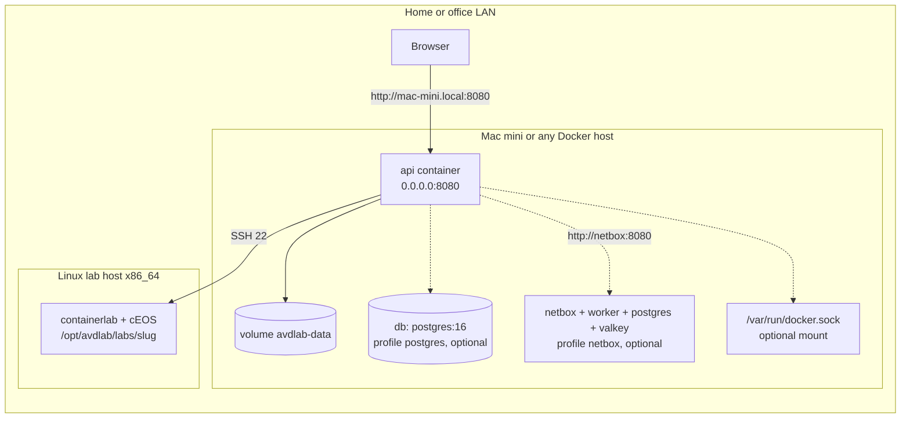


`docker compose up -d --build` in `deploy/` starts the `api` service only; it publishes port 8080 on all addresses
(`AVDLAB_BIND_ADDRESS=0.0.0.0`). Postgres and NetBox are separate compose **profiles** (`--profile postgres`,
`--profile netbox`). The Mac mini runs only the orchestrator; the labs run on a separate Linux lab host (cEOS-lab for
x86_64 is a Linux container and cannot run on macOS itself). Mounting `/var/run/docker.sock` is optional: it lets the API
use the local Docker engine to cache/import cEOS images and is required for the in-app self-update.

### Azure VM with public HTTPS

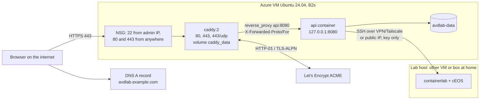


The compose profile `public` adds Caddy 2. Caddy obtains and renews a Let's Encrypt certificate for `AVDLAB_DOMAIN`
(certificates in the `caddy_data` volume), redirects port 80 to https, adds HSTS and security headers, and proxies
everything — WebSockets included — to `api:8080`. The API port is bound to `127.0.0.1` only, so the app is reachable
only through Caddy (or an `ssh -L 8080:127.0.0.1:8080` tunnel for debugging). The orchestrator VM is small (B2s,
2 vCPU / 4 GB); the lab host is the big machine and only needs to be reachable over SSH from the VM — through a VPN /
Tailscale, or over its public IP restricted to the VM's address. `deploy/azure/setup-azure-vm.sh` automates the VM
side (chapter 3).

### Jump host for Mac and Windows lab hosts (beta)

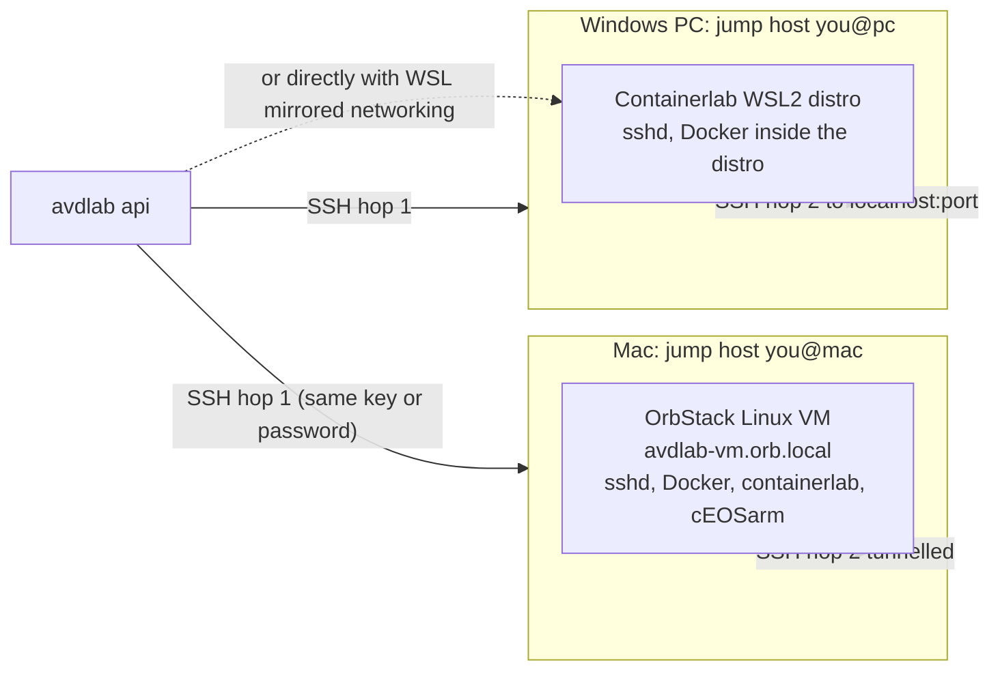


containerlab needs a Linux kernel, so on a Mac or a Windows PC the lab host is a **Linux VM on that machine**. Those VMs
are NATed behind their host, so a lab host can have a **jump host** (`[user@]host[:port]`): avdlab first connects to the
Mac or PC with the same key/password, then opens the SSH connection to the VM through that tunnel. Both hops' host keys
are pinned in `known_hosts`; commands, file sync and terminals all use the one tunnelled connection. Chapter 4 has the
setup steps.

## (c) Lab life cycle: create → build → deploy → validate

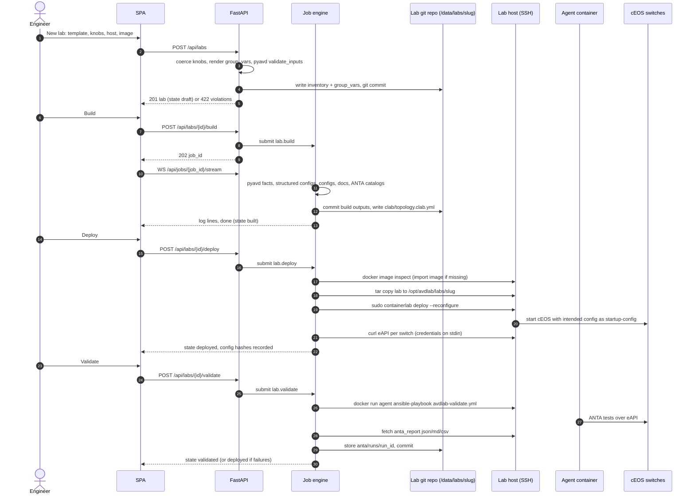

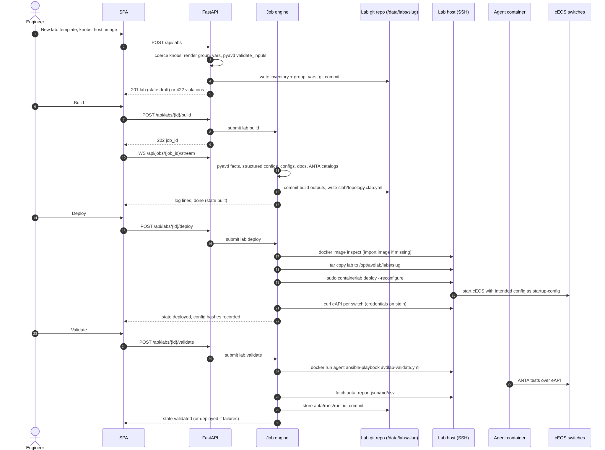

1–5 **Create.** `POST /api/labs` is inline: knob values are merged over the template defaults and coerced (types,
ranges, pool syntax); the generator renders inventory and group_vars; pyavd validates the resolved host variables. A
violation answers `422 {"detail": {"message", "violations": [{host?, path?, message}]}}` and nothing is written.
Otherwise the files are committed to a fresh git repository and the lab is `draft`.

6–13 **Build.** `lab.build` runs the pyavd pipeline in a thread, streams progress into the job log, commits all outputs
and generates `clab/` (and, for target `act`, the ACT topology). The job result lists the hosts, warnings, changed files
and ANTA test counts shown on the Build tab.

14–21 **Deploy.** `lab.deploy` refuses a lab that was never built or a host that was never probed / lacks Docker or
containerlab, and an image whose architecture does not match the host. It checks the image on the host (importing the
tarball from the image store when missing), copies the lab directory (excluding `.git` and reports), removes a stale
empty Docker network that still holds the lab's management subnet (left by a host crash), runs `containerlab deploy -t
clab/topology.clab.yml --reconfigure` with sudo, reads `containerlab inspect`, and polls eAPI on every cEOS node until
all answer or `wait_timeout` (600 s default) passes. The switches boot from their intended config (containerlab
`startup-config`); in ZTP mode they boot without one and fetch it from the `ztp` node instead. The SHA-256 of every
intended config is recorded so a later **Push config changes** knows what changed.

22–28 **Validate.** `lab.validate` writes `playbooks/avdlab-validate.yml` (AVD `anta_runner`, optional extra fabric
validation, skipped tests, tags, user catalogs), checks that the agent image ships ANTA ≥ the required minimum,
syncs the lab, runs the playbook in the agent container on the management network, pulls back `anta_report.{json,md,csv}`,
stores them under `anta/runs/<run_id>/`, commits, and sets the lab to `validated` (no failure and no error) or keeps it
`deployed`.

## (d) Job engine

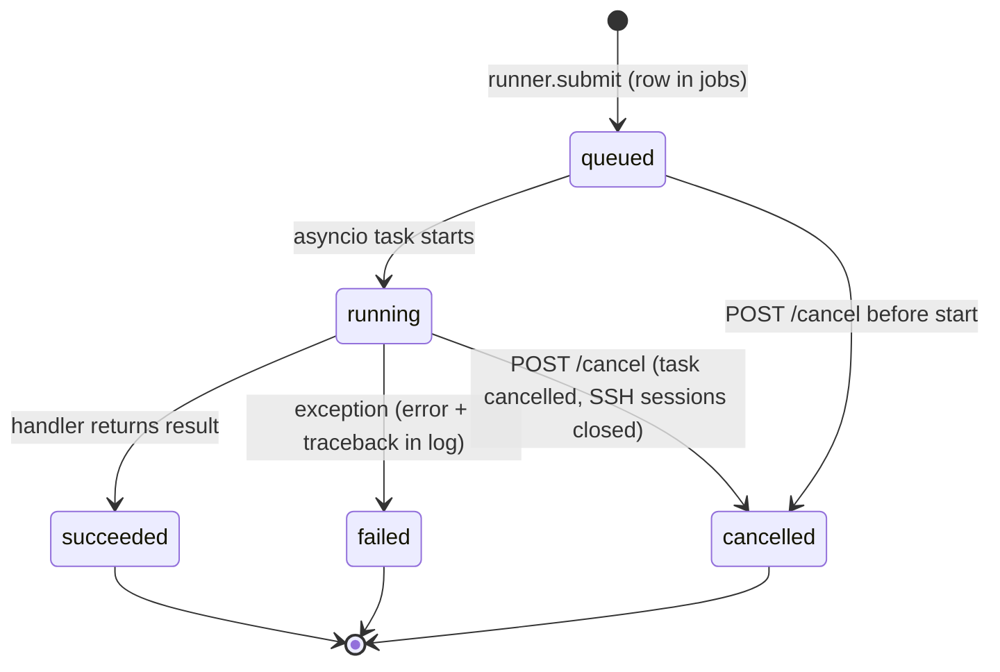

A job type is a coroutine registered with `@job("<type>")`. `runner.submit(type, params=, lab_id=, host_id=)` inserts
the row (`queued`), creates a `JobContext` (log file, cancel event, list of SSH connections it holds) and starts the
task. The task sets `running`, logs `job <id> (<type>) started`, awaits the handler and stores its return value as the
`result` (`succeeded`), or the exception text as `error` plus the traceback in the log (`failed`).

**Cancel** (`POST /api/jobs/{id}/cancel`, the *Kill* button) sets the cancel event, cancels the asyncio task and closes
every SSH connection the job registered — remote commands die with their session. An exception raised because its SSH
session was closed under it is recorded as `cancelled`, not `failed`.

**Streaming.** `WS /api/jobs/{id}/stream` first sends the existing log (`{"line": ...}` frames), then live lines, then
`{"done": true}`. Lines are timestamped `[HH:MM:SS]`. Secrets are masked before they reach the log in the jobs that
handle tokens (`masking_log`).

**Single process.** The engine lives in the API process. A job that was `queued` or `running` when the API stopped is
not resumed and its row is not reset (see the troubleshooting matrix in chapter 8).

## (e) Data model

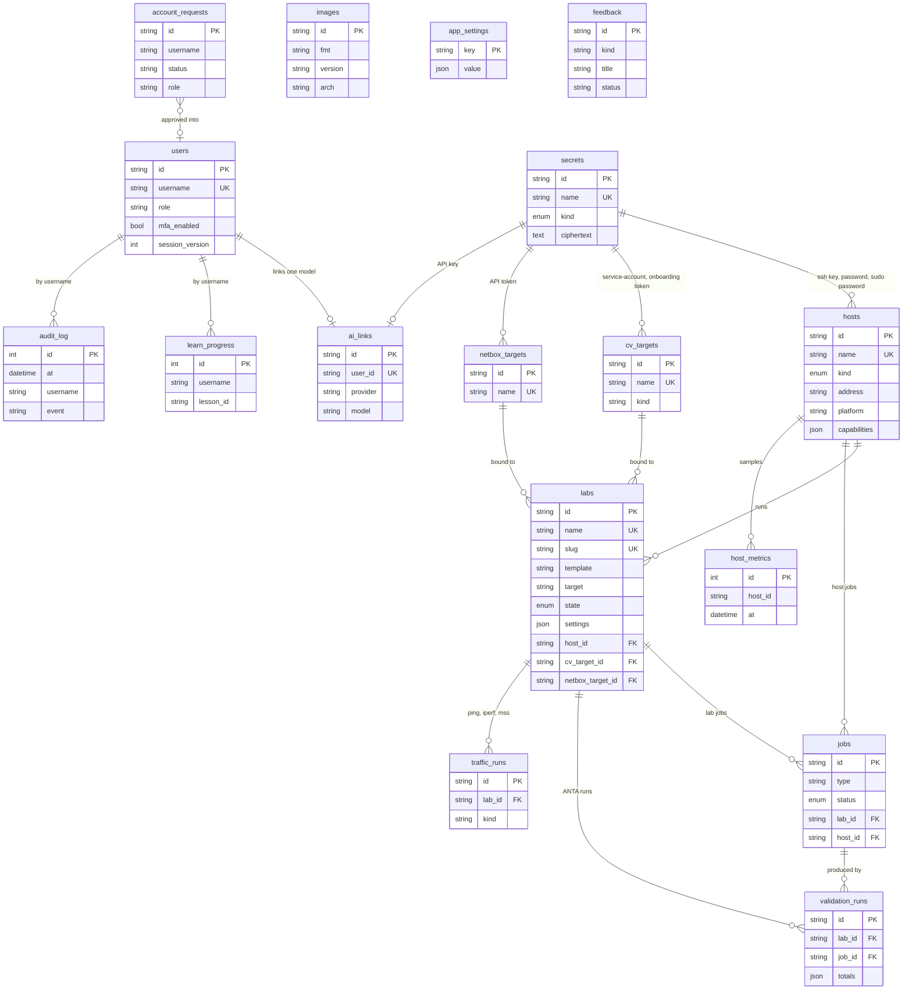


All models are in one module, `backend/avdlab/core/db.py`. Ids are 32-character hex UUIDs (integers for the
append-only tables `audit_log`, `learn_progress`, `host_metrics`). Only the columns that matter are drawn.

| Table | Holds | Notes |
|---|---|---|
| `users` | accounts | argon2id hash, role, `disabled`, `must_change_password`, TOTP secret (Fernet ciphertext), hashed recovery codes, `failed_logins` / `locked_until`, `session_version` |
| `secrets` | every credential | `kind` = `ssh_key`, `password`, `arista_token`, `cv_token`, `netbox_token`, `generic`; `ciphertext` is Fernet; `meta` holds non-secret facts (public key) |
| `hosts` | lab hosts | `kind` `linux`/`act`; FK to up to three secrets (key, password, sudo password); `capabilities` = last probe document |
| `images` | cEOS image store | unique `(fmt, version)`; `present_on_hosts` is a JSON list of host ids |
| `labs` | labs | `settings` JSON carries knob values, encrypted `secret_knobs`, `topology_overrides`, `pushed_configs`, last inspect/status/deploy/validation/CV/NetBox/ZTP results, git remote config |
| `jobs` | every job | `params`, `result`, `artefacts`, `error`, timestamps |
| `validation_runs` | ANTA runs | totals + path of the JSON report in the lab repo |
| `traffic_runs` | ping / iperf / MSS verification runs | `kind` = `ping`, `iperf` or `mss` |
| `cv_targets` | CloudVision targets | service-account and onboarding token secrets, `verify_certs` |
| `netbox_targets` | NetBox targets | token secret, `verify_certs` |
| `account_requests` | public sign-up requests | `pending` / `approved` / `rejected`, granted role, decision metadata |
| `app_settings` | admin-editable settings | key → JSON value; an unset key falls back to its `AVDLAB_*` env default |
| `ai_links` | one linked AI model per user | API key in `secrets` (write-only) |
| `audit_log` | sign-in and account events | username, event (`login.ok`, `login.failed`, `login.locked`, `mfa.enabled`, `ai.apply`, …), IP, user agent |
| `feedback` | in-app feedback | also written as `/data/feedback/<id>.md`; optional GitHub issue URL |
| `learn_progress` | passed lesson checkpoints | unique per (username, lesson, checkpoint) |
| `host_metrics` | monitor samples | pruned to 7 days |

`ai_links.user_id`, `host_metrics.host_id`, `learn_progress.username` and `audit_log.username` are logical links, not
database foreign keys.

## (f) Security model

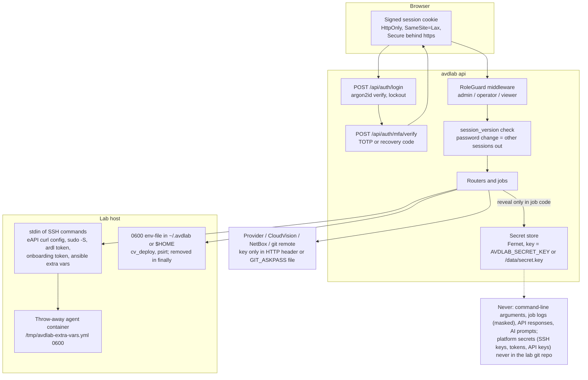


**Authentication.** `POST /api/auth/login` verifies the argon2id hash. Unknown users and wrong passwords get the same
error; after `AVDLAB_LOGIN_MAX_FAILURES` (5) failures the account is locked for `AVDLAB_LOGIN_LOCKOUT_MINUTES` (15).
With MFA enabled the session first holds only `mfa_pending_user_id` (nothing is granted), and
`POST /api/auth/mfa/verify` accepts a 6-digit TOTP code (30 s) or a single-use recovery code; 5 wrong codes restart the
sign-in. The full session is a signed cookie (Starlette `SessionMiddleware`, key `AVDLAB_SESSION_SECRET`, max age
`AVDLAB_SESSION_MAX_AGE` = 7 days) holding username, user id and `session_version`. It is always HttpOnly and
`SameSite=Lax`, and `Secure` when `AVDLAB_PUBLIC_URL` starts with `https://` (or `AVDLAB_SECURE_COOKIES=true`).

**Session invalidation.** Every request re-loads the user: a deleted or disabled user, or a `session_version` that no
longer matches, is anonymous. Changing or resetting a password bumps `session_version`, which signs out all other
sessions of that user, including open WebSockets (closed with code 4401).

**Authorisation.** `RoleGuard` (an ASGI middleware inside the session middleware) applies `role_denial(role, method,
path)` to every `/api/*` request and WebSocket upgrade:

| Rule | Effect |
|---|---|
| admin | allowed everywhere |
| `/api/users*`, `/api/admin*` | admin only (routers also check `require_role("admin")`) |
| `/api/register*` | public (account requests) |
| operator | everything else, except `DELETE /api/hosts/...` |
| viewer | `GET`/`HEAD`/`OPTIONS`, WebSocket streams, `POST /api/auth/*` (own password and MFA); never a `.../terminal` WebSocket |

Denied HTTP calls get `403 {"detail": "role viewer may not POST /api/labs"}`; denied WebSockets are closed with 4403.
Anonymous requests pass RoleGuard and are answered 401 by the routers, except the public endpoints (`/api/auth/login`,
`/api/auth/mfa/verify`, `/api/auth/policy`, `/api/register`, `/api/register/status/{id}`, `/api/meta`,
`/api/meta/changelog`, `/api/meta/notices`).

**Secret store.** Credentials are rows in `secrets`, encrypted with Fernet (`AVDLAB_SECRET_KEY`, or a key generated on
first start into `/data/secret.key`, mode 0600). List endpoints return names and kinds only; tokens on targets, the
arista.com token, the SMTP password and AI keys are **write-only** (`has_token`-style booleans come back). Only job and
service code calls `reveal()`. TOTP secrets of users are encrypted with the same key — **lose the key and every secret
and every MFA enrolment is unrecoverable**.

**Where credentials travel** (what reaches a lab host or an external service, and how):

| Credential | Path | Never |
|---|---|---|
| SSH private key / password | in memory to asyncssh | written to disk on the orchestrator outside the secret store |
| sudo password | `sudo -S` on stdin | on a command line |
| device password (eAPI) | `curl -K -` with the `user = "u:p"` line on stdin | on a command line or in the log |
| ansible credentials (config push, ACT deploy, test hosts) | stdin of `docker run -i`, copied to `/tmp/avdlab-extra-vars.yml` (0600) inside the throw-away container | `-e @/dev/stdin` (broken in Ansible, fixed in 0.7.2), host filesystem |
| CloudVision service-account token (cv_deploy) | 0600 env-file under `~/.avdlab/` on the lab host, passed with `--env-file`, removed in `finally` | the lab repo, a command line |
| ANTA credentials (PSIRT scan) | 0600 env-file in `$HOME`, removed in `finally` | same |
| CloudVision onboarding token | stdin of `docker exec -i <node>` writing the TerminAttr token file (plus a copy on flash) | `docker cp` (hidden by the cEOS tmpfs), the lab repo |
| ZTP bootstrap script / onboarding token | written by the deploy job into the remote `clab/ztp/www/` with mode 0600 via stdin | the lab repo |
| arista.com token | env of the local `ardl` process, or stdin of a remote `ardl` | logs |
| git remote token / SSH key | throw-away `GIT_ASKPASS` script reading a 0600 temp file / `GIT_SSH_COMMAND -i <0600 file>`, credential helper disabled, temp dir removed | `.git/config`, the stored URL, a command line |
| NetBox token, CloudVision REST token | `Authorization` header (pynetbox / httpx) | logs (masked) |
| AI API key | request header only; every provider error passes through `mask()` | logs, HTTP responses, the prompt |
| SMTP password | aiosmtplib login | logs and error messages |

The lab's **device password** knob is a lab credential, not a platform secret: by design it is rendered into the AVD
inputs (sha512 hash of the local user, type-7 BGP peer-group passwords, and `ansible_password` where the example has it),
so it is part of the lab repository and of any export or git push of that lab. The AI designer never sees it.

**HTTP hardening.** The app sets `X-Content-Type-Options: nosniff`, `X-Frame-Options: DENY` and
`Referrer-Policy: strict-origin-when-cross-origin` on every response; Caddy adds HSTS (`max-age=31536000`) and removes the
`Server` header. CORS allows the configured origins only (`AVDLAB_CORS_ORIGINS` + `AVDLAB_PUBLIC_URL`). Public account
requests are rate-limited to 5 per hour per IP; AI design calls to 30 per user per hour.

**SSH host keys.** Trust on first use: an unknown host key (and the jump host's) is fetched once and appended to
`/data/known_hosts`; a later mismatch fails the connection with a hint to remove the line if the host was reinstalled.

## (g) Request path through Caddy

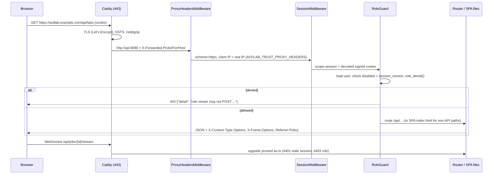

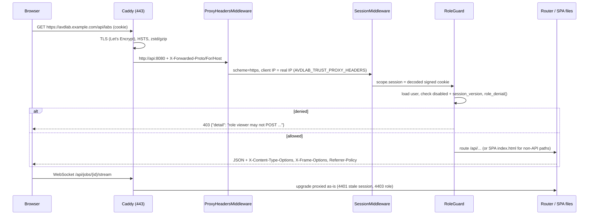

Caddy terminates TLS and forwards to `api:8080` on the compose network with `X-Forwarded-Proto/For/Host`. With
`AVDLAB_TRUST_PROXY_HEADERS=true` the app mounts uvicorn's `ProxyHeadersMiddleware` as the outermost layer, trusting all
hosts — safe only because the API port is bound to `127.0.0.1` and nothing but Caddy can reach it. Every inner layer then
sees `https` and the real client IP (used in the audit log and the registration rate limit). The image's own
`uvicorn --proxy-headers` default trusts only `127.0.0.1` and is not enough behind Caddy. The session middleware decodes
the cookie, RoleGuard authorises, and the router answers; non-API paths are served from the SPA build. WebSockets for job
logs and terminals pass through Caddy unchanged. Without the `public` profile the same chain runs without Caddy and
without the proxy-headers layer.
