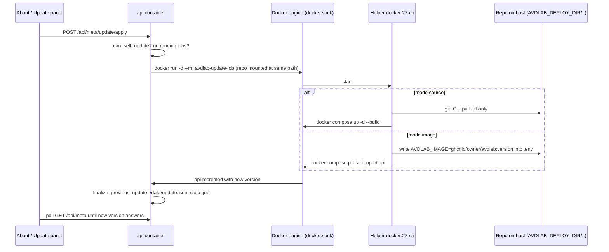
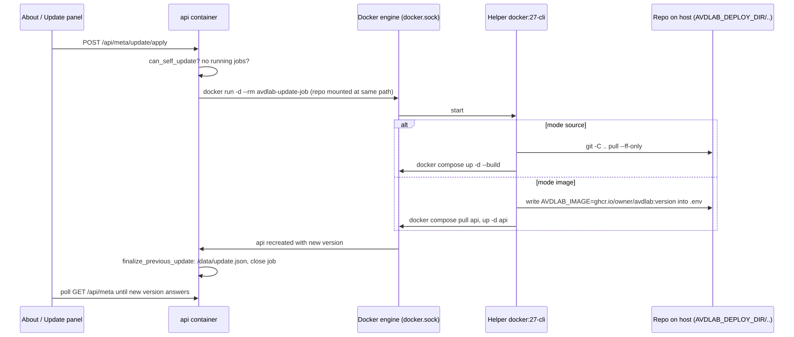

# 3. Installation, upgrades and backups

avdlab ships as one Docker image built from this repository (`deploy/Dockerfile.backend`: the SPA is built with Node 22,
the API runs on Python 3.11 with pyavd 6.4, ANTA 1.10, eos-downloader, git, openssh-client and the Docker CLI). It is
started with Docker Compose from the `deploy/` directory. Two supported installs:

| | LAN install | Public install |
|---|---|---|
| Typical machine | Mac mini, any Docker host | Azure VM (Ubuntu 24.04, B2s is enough) |
| Compose command | `docker compose up -d --build` | `docker compose --profile public up -d --build` |
| URL | `http://<host>:8080` | `https://<your domain>` |
| TLS | none (LAN only) | Caddy 2 + Let's Encrypt, automatic renewal |
| API port binding | `0.0.0.0:8080` | `127.0.0.1:8080` (only Caddy reaches it) |

In both cases the **labs run on a separate Linux lab host** reached over SSH (chapter 4). The orchestrator itself is
small; the lab host needs about 2 GB of RAM per cEOS node (the probe's rule of thumb) and enough disk for images.

## 3.1 Mac mini or any Docker host on a LAN

1. **Install a Docker engine.** Docker Desktop or OrbStack on macOS (turn on "start at login"), Docker Engine with the
   compose plugin on Linux. Keep a Mac from sleeping so jobs keep running:
   `sudo pmset -a sleep 0 disksleep 0` (or System Settings → Energy → *Prevent automatic sleeping*).
2. **Get the code** (git clone, or a release tarball — see 3.3) into e.g. `~/avdlab`.
3. **Configure:**
   ```bash
   cd ~/avdlab/deploy
   cp .env.example .env
   # edit .env:
   #   AVDLAB_ADMIN_PASSWORD   the first admin's password (≥ 12 chars, 3 of 4 classes)
   #   AVDLAB_SESSION_SECRET   openssl rand -hex 32
   #   AVDLAB_SECRET_KEY       python3 -c "from cryptography.fernet import Fernet; print(Fernet.generate_key().decode())"
   #                           (or leave empty: a key is generated into the data volume — back it up either way)
   ```
4. **Start:** `docker compose up -d --build`, then open `http://<mac-mini>.local:8080` and sign in as the admin
   (`AVDLAB_ADMIN_USER`, default `admin`). If the password is the default `change-me` or fails the policy, the app
   still starts but asks for a new password at the first sign-in.
5. **Optional Postgres:** set `AVDLAB_DATABASE_URL=postgresql+asyncpg://avdlab:<pw>@db:5432/avdlab` and
   `POSTGRES_PASSWORD=<pw>`, then `docker compose --profile postgres up -d`.
6. **Optional NetBox next to it:** set `NETBOX_SECRET_KEY` (`python3 -c "import secrets; print(secrets.token_urlsafe(50))"`),
   `NETBOX_API_TOKEN` (40 hex characters: `python3 -c "import secrets; print(secrets.token_hex(20))"`) and
   `NETBOX_SUPERUSER_PASSWORD`, then `docker compose --profile netbox up -d`. The first start runs migrations (a few
   minutes); NetBox is at `http://<docker-host>:8000` (`NETBOX_PORT`). In avdlab add a NetBox target with URL
   `http://netbox:8080` (same compose project) and that token.
7. **Optional Docker socket:** uncomment `- /var/run/docker.sock:/var/run/docker.sock` under `api.volumes` in
   `docker-compose.yml`. It lets the API import/cache cEOS images locally (`docker save` for pushes) and is required for
   the in-app update (3.3).
8. **Add a lab host** (chapter 4) and an image (chapter 5, Images).

Operate it with `docker compose logs -f api` (logs), `docker compose ps` (health: the image has a healthcheck on
`/api/auth/me` expecting 200 or 401), `docker compose restart api`.

## 3.2 Azure VM with public HTTPS

### Before you start

1. **DNS first.** Create the A record `<domain>` → the VM's public IP **before** the first start. Caddy requests the
   certificate immediately; repeated failures run into Let's Encrypt rate limits. For a dry run set
   `AVDLAB_ACME_STAGING=true` (staging CA, browsers warn); to switch to a real certificate afterwards, remove the setting,
   `docker compose --profile public down` and `docker volume rm avdlab_caddy_data`.
2. **Network security group.** Inbound **22** from your own IP only, **80** and **443** from anywhere (80 is needed for
   the ACME HTTP-01 challenge and the redirect). Do **not** open 8080.
3. **VM size.** B2s (2 vCPU / 4 GB) with Ubuntu 24.04 runs the orchestrator. The lab host is a different, bigger machine
   (or the same VM if it is big enough — then set `AVDLAB_REMOTE_ROOT` to e.g. `/opt/avdlab-labs` so labs do not land in
   the app checkout).

### Setup script

```bash
curl -fsSLO https://raw.githubusercontent.com/<owner>/<repo>/main/deploy/azure/setup-azure-vm.sh   # or scp it
sudo bash setup-azure-vm.sh <git-url | release-tarball-url | tarball-path> avdlab.example.com you@example.com [admin-password]
```

`deploy/azure/setup-azure-vm.sh` is idempotent (safe to re-run):

| Step | What it does |
|---|---|
| 1 | installs Docker Engine + the compose plugin from `download.docker.com` (only when missing) |
| 2 | puts the code in `/opt/avdlab` — `git clone` / `git pull`, or unpacks the tarball over it (`--strip-components=1`) |
| 3 | creates `deploy/.env` from `.env.example` (an existing `.env` is kept) and sets `AVDLAB_DOMAIN`, `AVDLAB_ACME_EMAIL`, `AVDLAB_PUBLIC_URL=https://<domain>`, `AVDLAB_TRUST_PROXY_HEADERS=true`, `AVDLAB_BIND_ADDRESS=127.0.0.1`; generates `AVDLAB_ADMIN_PASSWORD` (unless given or already non-default) and `AVDLAB_SESSION_SECRET` when they are defaults, and prints generated values once |
| 4 | `docker compose --profile public up -d --build` |

The script opens no firewall ports (that is the NSG's job).

### By hand

Set these keys in `deploy/.env`, then `cd /opt/avdlab/deploy && docker compose --profile public up -d --build`:

| Key | Value |
|---|---|
| `AVDLAB_DOMAIN` | `avdlab.example.com` (the A record) |
| `AVDLAB_ACME_EMAIL` | your address (Let's Encrypt account, expiry mails) |
| `AVDLAB_PUBLIC_URL` | `https://avdlab.example.com` — makes the session cookie `Secure` and is added to the CORS origins |
| `AVDLAB_TRUST_PROXY_HEADERS` | `true` — honour `X-Forwarded-Proto/For` from Caddy (real client IPs in the audit log) |
| `AVDLAB_BIND_ADDRESS` | `127.0.0.1` |
| `AVDLAB_ADMIN_PASSWORD` | a strong password; turn on MFA for internet-facing installs |
| `AVDLAB_SESSION_SECRET` | `openssl rand -hex 32` |
| `AVDLAB_SECURE_COOKIES` | optional; empty = follow `AVDLAB_PUBLIC_URL`, `true`/`false` forces it |

### Check it

- `docker compose --profile public logs caddy` → look for `certificate obtained successfully`.
- `curl -I https://avdlab.example.com` → `HTTP/2 200` with a `strict-transport-security` header.
- Renewal is automatic (about 30 days before expiry); certificates and the ACME account live in `caddy_data`.
- With a `Secure` cookie, sign-in works only over https: through `ssh -L 8080:127.0.0.1:8080 <vm>` you see the login
  page but do not stay signed in.

### Reaching the lab host from Azure

The orchestrator only needs **SSH** to the lab host (job logs and web terminals are proxied over that connection):

- a VPN or Tailscale between the VM and the lab host (best when the lab host is at home or on a LAN), or
- SSH to the lab host's public IP with key authentication only (Hosts → *Generate SSH key*), with the lab host's
  firewall/NSG allowing 22 only from the VM's IP.

The request path through Caddy and the middlewares is drawn in chapter 2 §(g).

## 3.3 Upgrading

Three ways, all keep the `avdlab-data` volume (and therefore labs, users, secrets):

### Release tarball

```bash
tar -xzf ~/Downloads/avdlab-vX.Y.Z.tar.gz -C ~        # writes into ~/avdlab
cd ~/avdlab/deploy && docker compose up -d --build
```

Extract in a terminal so existing files are overwritten. Double-clicking the archive in Finder unpacks it *next to* the
existing folder and renames conflicting files to `name 2.ts`, `name 3.ts`, which breaks the TypeScript build; clean up
with `find ~/avdlab -name "* [0-9].*" -not -path "*/node_modules/*" -delete`.

### git

```bash
cd ~/avdlab && git pull && cd deploy && docker compose up -d --build
```

To bake the build info shown on About / `GET /api/meta`:
`AVDLAB_GIT_SHA=$(git rev-parse --short=12 HEAD) AVDLAB_BUILD_DATE=$(date -u +%FT%TZ) docker compose build`.

### In-app update

The sidebar version badge shows an *update available* pill when a newer release exists; About and Changelog have an
**Updates** panel with *Check now* and *Update now*.

| Requirement | Setting / action |
|---|---|
| where to look | `AVDLAB_UPDATE_SOURCE=github:<owner>/<repo>` (latest GitHub release) or a manifest URL returning `{"latest", "url", "notes", "published_at", "image"}`; empty = no checks |
| how often | `AVDLAB_UPDATE_CHECK_INTERVAL` hours (24); first check a few seconds after start, never blocking it; *Check now* forces one |
| how to update | `AVDLAB_UPDATE_MODE`: `source` (default; the checkout must be a git clone: `git pull --ff-only` + `docker compose up -d --build`), `image` (writes `AVDLAB_IMAGE=ghcr.io/<owner>/avdlab:<version>` into `.env`, then `docker compose pull api && docker compose up -d api`), `manual` (notify only) |
| Docker access | the `/var/run/docker.sock` volume uncommented |
| where the repo is | `AVDLAB_DEPLOY_DIR` = absolute **host** path of `deploy/`; compose passes `${PWD}`, so run compose from `deploy/` (or set it explicitly) |
| no running jobs | the update is refused with 409 while any job runs |





The job `app.update` starts a **detached** helper container (`AVDLAB_UPDATE_HELPER_IMAGE`, `docker:27-cli`) with the
Docker socket and the repository mounted at the same path as on the host, so it survives the API being recreated. The
API follows its output into `/data/update.log`; the next API process reads `/data/update.json`, records
`last_update: {from, to, at, ok}` and closes the job. The UI polls `/api/meta` until the new version answers; if it does
not, check `data/update.log`.

### Database and settings on upgrade

New tables are created and new columns added automatically at startup. Settings stored on **Admin settings** (database)
win over `.env`, so an upgrade never overwrites them. When the `users` table is empty (first start, or an upgrade from a
pre-0.8.0 single-admin install), the admin is created from `AVDLAB_ADMIN_USER` / `AVDLAB_ADMIN_PASSWORD`; afterwards those
variables are no longer used.

## 3.4 Backups

All app state is in the **`avdlab-data`** volume (mounted at `/data`):

| Path in the volume | Content | Why it matters |
|---|---|---|
| `avdlab.db` | the SQLite database (unless Postgres) | users, hosts, labs, jobs, targets, settings, secrets (encrypted) |
| `secret.key` | the Fernet key (unless `AVDLAB_SECRET_KEY` is set) | without it every stored secret **and every user's MFA** is lost |
| `known_hosts` | pinned SSH host keys of lab hosts and jump hosts | losing it only means TOFU again; keeping it protects against a swapped host |
| `labs/<slug>/` | every lab as a git repository, including build outputs, ANTA runs, snapshots | the labs themselves |
| `jobs/<id>/log.txt` | job logs and artefacts | history, troubleshooting |
| `images/` | downloaded cEOS tarballs | can be re-downloaded |
| `feedback/`, `update.json`, `update.log`, `update-check.json` | feedback copies, update bookkeeping | |

```bash
cd ~/avdlab/deploy        # or /opt/avdlab/deploy
docker run --rm -v avdlab_avdlab-data:/data -v $PWD:/b alpine tar czf /b/avdlab-data-$(date +%F).tgz -C /data .
```

Keep `deploy/.env` with the archive (it holds `AVDLAB_SESSION_SECRET` and possibly `AVDLAB_SECRET_KEY`). With Postgres,
back up `avdlab-pg` as well (`pg_dump`). On Azure copy the archive off the VM (Blob Storage, or an Azure Backup policy on
the disk). To restore, stop the stack, extract the archive into an empty `avdlab-data` volume, restore `.env`, start.

**Lost the only admin password?** Stop the app, empty the users table (`sqlite3 /data/avdlab.db "DELETE FROM users"` —
this removes all accounts) and start again: the admin is re-created from the environment variables.

## 3.5 Settings reference

Every field of `backend/avdlab/core/config.py` (and the auth settings in `core/passwords.py`) can be set as
`AVDLAB_<NAME>` in `deploy/.env`. Values marked **(admin setting)** are only defaults: the value saved on *Admin settings*
in the database wins.

### Storage, paths, database

| Variable | Default | Meaning |
|---|---|---|
| `AVDLAB_DATA_DIR` | `/data` | root for `labs/`, `images/`, `jobs/`, `known_hosts`, `secret.key` (compose forces `/data`) |
| `AVDLAB_TEMPLATES_DIR` | `<repo>/templates` (image: `/app/templates`, set in `.env.example`) | lab templates |
| `AVDLAB_DATABASE_URL` | `sqlite+aiosqlite:////data/avdlab.db` | or `postgresql+asyncpg://user:pw@db:5432/avdlab` |
| `AVDLAB_META_DIR` | repo root | directory holding `VERSION`, `CHANGELOG.md`, `LICENSE`, `THIRD_PARTY_NOTICES.md` |

### Authentication and sessions

| Variable | Default | Meaning |
|---|---|---|
| `AVDLAB_ADMIN_USER` | `admin` | first admin, created only while the users table is empty |
| `AVDLAB_ADMIN_PASSWORD` | `change-me` | its password; default or weak → forced change at first sign-in |
| `AVDLAB_SESSION_SECRET` | `change-me-session-secret` | signs the session cookie — **set it** |
| `AVDLAB_SESSION_MAX_AGE` | `604800` (7 days) | cookie lifetime in seconds |
| `AVDLAB_SECRET_KEY` | empty | Fernet key of the secret store; empty = generated into `<data_dir>/secret.key` |
| `AVDLAB_PASSWORD_MIN_LENGTH` | `12` | minimum password length (never below 8) |
| `AVDLAB_LOGIN_MAX_FAILURES` | `5` | consecutive wrong passwords before lockout |
| `AVDLAB_LOGIN_LOCKOUT_MINUTES` | `15` | lockout duration |
| `AVDLAB_MFA_ISSUER` | `avdlab` | issuer label in authenticator apps |

### Public deployment (compose profile `public`)

| Variable | Default | Meaning |
|---|---|---|
| `AVDLAB_PORT` | `8080` | published host port of the API (compose only) |
| `AVDLAB_BIND_ADDRESS` | `0.0.0.0` | host address the API port binds to; `127.0.0.1` with the public profile (compose only) |
| `AVDLAB_DOMAIN` | — | DNS name for Caddy (compose/Caddy only) |
| `AVDLAB_ACME_EMAIL` | — | ACME account e-mail (compose/Caddy only) |
| `AVDLAB_ACME_STAGING` | `false` | `true` = Let's Encrypt staging CA (compose/Caddy only) |
| `AVDLAB_PUBLIC_URL` | empty | the URL users open; `https://…` → Secure cookie; appended to CORS origins; used in mails and as SMTP from-domain |
| `AVDLAB_SECURE_COOKIES` | empty | force the cookie's Secure flag (`true`/`false`); empty = derived from `AVDLAB_PUBLIC_URL` |
| `AVDLAB_TRUST_PROXY_HEADERS` | `false` | trust `X-Forwarded-Proto/For` (only with the API not publicly reachable) |
| `AVDLAB_CORS_ORIGINS` | `["http://localhost:5173","http://localhost:8080"]` | JSON list; only needed for the Vite dev server |

### Lab hosts and images

| Variable | Default | Meaning |
|---|---|---|
| `AVDLAB_AGENT_IMAGE` | `ghcr.io/aristanetworks/avd/universal:python3.11-avd-v6.4.0` | container run on the lab host for ANTA, cv_deploy, config pushes, ZTP node; bootstrap pulls it |
| `AVDLAB_CLAB_IMAGE` | `ghcr.io/srl-labs/clab:latest` | containerlab image for bootstrap's container mode |
| `AVDLAB_ANTA_IMAGE` | `ghcr.io/aristanetworks/anta:1.10.0` | image for the PSIRT scan (`anta psirt`), pulled on first use |
| `AVDLAB_HOST_IMAGE` | `ghcr.io/srl-labs/network-multitool:latest` | linux client containers (knob `client_image` wins per lab) |
| `AVDLAB_REMOTE_ROOT` | `/opt/avdlab` | root directory on the lab host; labs go to `<root>/labs/<slug>` |
| `AVDLAB_AVD_VERSION` | `6.4.0` | AVD version for the native toolchain install and display |
| `AVDLAB_ANTA_VERSION` | `1.10.0` | ANTA version for the native toolchain install and display |
| `AVDLAB_MONITOR_ENABLED` | `true` | host metrics sampler; `false` = no background SSH at all |
| `AVDLAB_MONITOR_INTERVAL` | `20.0` | sampling interval in seconds |

### About, feedback, updates

| Variable | Default | Meaning |
|---|---|---|
| `AVDLAB_COPYRIGHT` | `© 2026 Dietrich De Bruyne — Systems Engineer, Arista Networks` | About page / meta |
| `AVDLAB_GIT_SHA`, `AVDLAB_BUILD_DATE` | empty | baked into the image at build time (build args) |
| `AVDLAB_FEEDBACK_GITHUB_REPO` | empty | `owner/repo`; with a secret named `github_token`, every feedback entry becomes a GitHub issue (label `feedback`) |
| `AVDLAB_UPDATE_SOURCE` | empty | `github:<owner>/<repo>` or a manifest URL; empty = no update checks |
| `AVDLAB_UPDATE_MODE` | `source` | `source`, `image` or `manual` |
| `AVDLAB_UPDATE_CHECK_INTERVAL` | `24.0` | hours; `0` = no background check |
| `AVDLAB_DEPLOY_DIR` | compose: `${PWD}` | host path of `deploy/` (self-update) |
| `AVDLAB_UPDATE_DOCKER_SOCKET` | `/var/run/docker.sock` | socket that must be mounted for self-update |
| `AVDLAB_UPDATE_HELPER_IMAGE` | `docker:27-cli` | detached helper running git/compose |
| `AVDLAB_IMAGE` | `avdlab/api:latest` | image name of the api service (compose; rewritten by image-mode updates) |

### Admin settings defaults (UI wins)

| Variable | Default | Meaning |
|---|---|---|
| `AVDLAB_APP_TITLE` | `avdlab` | name in the UI and e-mails (admin setting) |
| `AVDLAB_GITHUB_URL` | empty | GitHub button in top bar, dashboard, register page (admin setting) |
| `AVDLAB_SUPPORT_EMAIL` | empty | contact on register and About pages (admin setting) |
| `AVDLAB_REGISTRATION_ENABLED` | `true` | public *Request an account* form (admin setting) |
| `AVDLAB_INTRO_VIDEO_URL` | `/intro/avdlab-intro.mp4` | dashboard intro video; empty hides it (admin setting) |
| `AVDLAB_FEEDBACK_MAIL_TO` | `dietrich@arista.com` | feedback and test-mail recipient(s), comma-separated (admin setting) |
| `AVDLAB_FEEDBACK_MAIL_ENABLED` | `true` | mail every new feedback entry (admin setting) |
| `AVDLAB_REGISTRATION_MAIL_TO` | empty (= feedback address) | account-request recipient(s) (admin setting) |
| `AVDLAB_SMTP_HOST` | empty | SMTP server; empty = no e-mail (admin setting) |
| `AVDLAB_SMTP_PORT` | `587` | `465` = implicit TLS (admin setting) |
| `AVDLAB_SMTP_USER` | empty | login; empty = no login (admin setting) |
| `AVDLAB_SMTP_PASSWORD` | empty | fallback; the encrypted secret `smtp_password` set in the UI wins |
| `AVDLAB_SMTP_STARTTLS` | `true` | STARTTLS (ignored on 465) (admin setting) |
| `AVDLAB_SMTP_FROM` | empty (= `avdlab@<host of AVDLAB_PUBLIC_URL or localhost>`) | sender (admin setting) |

### AI designer defaults (UI wins)

| Variable | Default | Meaning |
|---|---|---|
| `AVDLAB_AI_DEFAULT_PROVIDER` | empty | `anthropic` or `openai` (OpenAI-compatible); empty = no shared model (admin setting) |
| `AVDLAB_AI_DEFAULT_BASE_URL` | empty | empty = the provider's public API (admin setting) |
| `AVDLAB_AI_DEFAULT_MODEL` | empty | model name (admin setting) |
| `AVDLAB_AI_DEFAULT_API_KEY` | empty | fallback; the encrypted secret `ai_default_api_key` set in the UI wins |
| `AVDLAB_AI_SHARED_ALLOWED` | `false` | users without their own link may use the shared model (admin setting) |
| `AVDLAB_AI_RATE_LIMIT` | `30` | design calls per user per hour |
| `AVDLAB_AI_TIMEOUT` | `180.0` in code (`.env.example` and README say 120) | seconds per provider request |

### Other compose variables (not read by the app)

| Variable | Default | Meaning |
|---|---|---|
| `POSTGRES_PASSWORD` | `avdlab` | password of the `db` service (profile `postgres`) |
| `NETBOX_VERSION` | `v4.2` | NetBox image tag (profile `netbox`) |
| `NETBOX_PORT` | `8000` | published NetBox port |
| `NETBOX_SECRET_KEY` | — (required) | Django secret key of NetBox |
| `NETBOX_API_TOKEN` | — (required) | 40-hex superuser API token |
| `NETBOX_SUPERUSER_NAME` / `_EMAIL` / `_PASSWORD` | `admin` / `admin@example.com` / `admin` (compose default; `.env.example` sets `change-me`) | NetBox superuser |
| `NETBOX_DB_PASSWORD`, `NETBOX_REDIS_PASSWORD` | `netbox` | NetBox Postgres and Valkey passwords |

Compose volumes: `avdlab-data`, `avdlab-pg`, `caddy_data`, `caddy_config`, `netbox-media`, `netbox-pg`, `netbox-redis`.
The project name is `avdlab`, so the data volume is `avdlab_avdlab-data` on the host.
