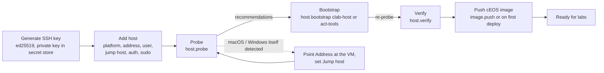

# 4. Lab hosts

A **lab host** is the machine that runs containerlab and the cEOS-lab containers. avdlab reaches it only over **SSH**:
every command, file copy, container action, web terminal and monitoring sample goes through an SSH connection made with
`asyncssh`. Nothing is installed on the lab host except what the bootstrap recipe installs (Docker, containerlab,
sysctls, a working directory and container images).





## 4.1 Requirements

| Item | Requirement | Checked by |
|---|---|---|
| OS | Debian/Ubuntu family or RHEL family (RHEL, Fedora, CentOS, Rocky, AlmaLinux, Oracle Linux) — detected from `/etc/os-release` `ID`/`ID_LIKE` | probe, bootstrap |
| CPU architecture | x86_64 for cEOS / cEOS64 images; arm64 (aarch64) for cEOSarm | probe; deploy refuses a mismatch |
| SSH | sshd reachable from the orchestrator (directly or via a jump host); key or password auth | every job |
| root | passwordless sudo (`NOPASSWD`) **or** a sudo password stored on the host | probe (`sudo -n true`, then a real `sudo` with the stored password) |
| RAM | rule of thumb 2 GB per cEOS node (probe prints "roughly N cEOS nodes") — an 8-switch fabric wants 16 GB | probe recommendation |
| Disk | ≥ 20 GB free for Docker (`/var/lib/docker` or `/`); cEOS images are ~2 GB each | probe recommendation |
| Network | outbound HTTPS for `get.docker.com`, `containerlab.dev`, `ghcr.io` during bootstrap; to CloudVision (443) if labs stream to CVaaS | — |

The kind of a host is `linux` (a containerlab host, the default) or `act` (the tools server of an Arista Cloud Test lab;
bootstrapped with recipe `act-tools`).

## 4.2 Adding a Linux host

1. **Hosts → Generate SSH key.** Creates an ed25519 key pair; the private key goes into the secret store (kind
   `ssh_key`), the public key is shown once with *Copy public key* and *Copy install command*
   (`echo '<key>' >> ~/.ssh/authorized_keys`). Add it to the SSH user on the lab host.
2. **Give the user root.** Either passwordless sudo:
   ```bash
   echo "$USER ALL=(ALL) NOPASSWD:ALL" | sudo tee /etc/sudoers.d/avdlab
   ```
   or enter a **sudo password** in the host form (stored encrypted, sent with `sudo -S` on stdin). With SSH password
   authentication the SSH password is reused for sudo unless a separate sudo password is set.
3. **Hosts → Add host.** Platform *Linux server or VM*, name, kind *containerlab host*, address, SSH user (default
   `ubuntu`) and port, authentication (*SSH key* → pick the key secret; or *Password* → existing secret or a new
   password), optional sudo password.
4. **Probe** (row action). See 4.6.
5. **Bootstrap** with recipe `clab-host` (4.3). The job re-probes at the end.
6. **Verify** (4.4).

The first connection pins the host key (trust on first use) in `/data/known_hosts`. If the host is reinstalled later,
the connection fails with *host key mismatch* — remove its line from `known_hosts` (in the data volume) and connect again.

SSH connects with a 30 s timeout and retries transient TCP/handshake failures 3 times with a 3 s backoff;
authentication failures are not retried (retrying a bad credential only locks accounts).

## 4.3 Bootstrap recipe `clab-host`

Bootstrap runs a **recipe**: an ordered list of steps, each with a *check* and an *apply* command. For every step the
engine runs *check* first (passes → `[skip]`), otherwise *apply* then *check* again (`[ok]`, or `[FAIL]` which aborts the
recipe). Steps that do not apply to the chosen options are skipped without running. Re-running is always safe.

| # | Step | Check | Apply | When |
|---|---|---|---|---|
| 1 | base packages | `dpkg -s` / `rpm -q` of curl, ca-certificates, rsync, git, python3, jq | `apt-get install` / `dnf install` | always |
| 2 | docker engine | `docker info` | `curl -fsSL https://get.docker.com \| sh && systemctl enable --now docker` | always |
| 3 | docker group membership | user in group `docker` | `usermod -aG docker <user>` | always |
| 4 | containerlab (native) | `containerlab version` | `curl -sL https://containerlab.dev/setup \| bash -s "all"` | mode *native* (default) |
| 5 | containerlab image (container mode) | `docker image inspect ghcr.io/srl-labs/clab:latest` | `docker pull` | mode *container* |
| 6 | containerlab wrapper (container mode) | `/usr/local/bin/containerlab` is the avdlab wrapper | write a wrapper that runs `docker run --rm --privileged --network host --pid host` with the Docker socket, netns, `/etc/hosts` and the current directory mounted | mode *container* |
| 7 | sysctls | each value ≥ target and `/etc/sysctl.d/90-avdlab.conf` exists | write the file, `sysctl --system` | always |
| 8 | remote root | `/opt/avdlab` exists and is owned by the SSH user | `mkdir -p`, `chown` | always |
| 9 | agent image | `docker image inspect <AVDLAB_AGENT_IMAGE>` | `docker pull` (30 min timeout) | always |
| 10 | pipx | `command -v pipx` | apt/dnf `pipx` (or pip) | *native toolchain* ticked |
| 11 | pyavd (native toolchain) | `pipx list` has `pyavd 6.4.0` | `pipx install "pyavd[ansible]==6.4.0"` | *native toolchain* ticked |
| 12 | anta (native toolchain) | `pipx list` has `anta 1.10.0` | `pipx install "anta[cli]==1.10.0"` | *native toolchain* ticked |
| 13 | arista.avd collection (native toolchain) | `ansible-galaxy collection list arista.avd` = 6.4.0 | `ansible-galaxy collection install arista.avd:==6.4.0` | *native toolchain* ticked |

Sysctl targets (also what the probe compares against):

| sysctl | target | why |
|---|---|---|
| `fs.inotify.max_user_instances` | 64000 | many cEOS nodes; the default is too low for > 10 nodes |
| `fs.inotify.max_user_watches` | 1048576 | same |
| `net.ipv4.ip_forward` | 1 | routing between container networks |
| `vm.max_map_count` | 262144 | |
| `fs.file-max` | 2097152 | |

Steps 1–9 run with sudo; the native toolchain steps run as the SSH user (`~/.local/bin`). The native toolchain is only
for people who want to use pyavd/ANTA in a shell on the host; avdlab itself always uses the agent container.

Bootstrap options in the dialog: **containerlab mode** (*native install* or *container wrapper*) and **Also install the
native toolchain**. After a fresh `usermod -aG docker`, the group only applies to new logins; avdlab detects whether the
user can run Docker and uses sudo for Docker commands when it cannot.

**Recipe `act-tools`** (for hosts of kind `act`, the ACT tools server) is the subset: base packages, docker engine,
docker group membership, remote root, agent image — no containerlab, no sysctls.

## 4.4 Verify

`host.verify` runs `containerlab version` (not on `act` hosts) and starts the agent image once
(`python3 -c 'import pyavd, anta; print(...)'`), then re-probes. The job result lists each check with its output tail and
the remaining recommendations.

## 4.5 Mac and Windows lab hosts (beta)

containerlab needs a Linux kernel (netlink, veth, network namespaces) and does not run on macOS or Windows natively. On
those machines the lab host is a **Linux VM on that machine**, and avdlab treats it exactly like a Linux host. Because
those VMs sit behind NAT on the Mac or PC, the host can have a **jump host**.

> **Beta — not yet field-tested.** Probe output and the Feedback button help to fix what breaks.

When you add a host, the dialog asks for the **platform** first (three cards; the choice is stored on the host and the
probe double-checks it). The setup steps it shows are:

### Mac (OrbStack VM)

*Apple Silicon or Intel; the lab runs in an OrbStack Linux VM.*

1. On the Mac: install OrbStack (orbstack.dev) and open it once.
2. Terminal: `orb create ubuntu avdlab-vm`
3. Terminal: `orb -m avdlab-vm sudo apt-get install -y openssh-server && orb -m avdlab-vm sudo systemctl enable --now ssh`
4. Give the VM memory in OrbStack → Settings (16 GB+ for an 8-switch fabric).
5. Below: Address `avdlab-vm.orb.local`, SSH user = your Mac user name (OrbStack creates it in the VM with your SSH
   key), Jump host = `you@<the Mac>`.
6. Save → Probe → Bootstrap. On Apple Silicon use cEOSarm images (New lab switches to arm64 automatically).

### Windows (WSL2)

*The lab runs in the Containerlab WSL2 distribution.*

1. PowerShell: `wsl --install`, then install the Containerlab distribution from containerlab.dev/windows
   (`wsl --install --from-file clab.wsl`); WSL ≥ 2.4.4.
2. In the distro: `sudo apt-get install -y openssh-server && sudo systemctl enable --now ssh`. Keep Docker Desktop's WSL
   integration OFF for this distro.
3. Make it reachable: `%UserProfile%\.wslconfig` → `[wsl2] networkingMode=mirrored, memory=20GB`; Windows Firewall rule for
   TCP 22 — or run OpenSSH on Windows and use it as the Jump host with Address `localhost`.
4. Below: Address = the PC (mirrored) or `localhost` (jump), SSH user = your WSL user, Jump host = `you@<the PC>` if used.
5. Save → Probe → Bootstrap.

### The jump host field

| Field | Format | Notes |
|---|---|---|
| Jump host | `[user@]host[:port]` | user defaults to the host's SSH user, port to 22 |
| Address | the VM **as seen from the jump host** | `avdlab-vm.orb.local` on a Mac; `localhost` (with the distro's sshd port in *Port*) on Windows |
| Credentials | the same key / password is used on both hops | put the public key on the Mac/PC **and** in the VM |

avdlab connects to the jump host first, then opens the connection to the VM through it; host keys of both hops are
pinned. All traffic — commands, file sync, terminals, monitoring — uses that tunnelled connection. The field is shown
only for the Mac and Windows platforms (choosing *Linux* clears it).

### What the probe says on these platforms

| Detected | How | Probe / bootstrap behaviour |
|---|---|---|
| OrbStack VM on macOS | `/etc/orbstack*` or `/opt/orbstack-guest` present | violet *OrbStack VM on macOS · beta* badge; recommendation to give the VM 16 GB+ and to use cEOSarm on Apple Silicon |
| WSL2 on Windows | `microsoft` / `WSL` in the kernel or `/proc/version`, `/run/WSL`, `WSLInterop` | *WSL2 on Windows · beta* badge; recommendations for Docker inside the distro, sshd + mirrored networking, `.wslconfig` memory; an extra warning when `docker context` points at Docker Desktop |
| the Mac itself (Darwin) | `uname -s` = Darwin | *macOS (not a lab host)*; bootstrap stops with the OrbStack instructions (address = the VM, jump host = the Mac) |
| Windows itself (OpenSSH for Windows) | `%OS%` = Windows_NT | *Windows (not a lab host)*; bootstrap stops with the WSL instructions |
| platform declared ≠ detected | declared *Mac* but plain Linux, declared *Linux* but WSL/OrbStack, … | a recommendation explains the mismatch (e.g. "this address is the Mac itself, not the Linux VM on it") |

Picking an arm64 host in **New lab** switches the `ceos_arch` knob to `arm64` (and clears the chosen image so you pick a
cEOSarm one).

Not implemented yet (roadmap in `docs/multi-os-hosts.md`): WSL-specific bootstrap steps, and a `local` host kind that
runs containerlab through the orchestrator's own Docker socket without SSH.

## 4.6 Probe output explained

`host.probe` runs a fixed set of independent shell commands (a failing command is tolerated: its raw output is kept and
the parsed value is empty), stores the parsed **capabilities** document on the host, and turns it into
**recommendations**. The Hosts list shows OS, Docker, containerlab, the number of recommendations and the probe age;
clicking a host name opens the **Capabilities** panel:

| Panel section | Field | Source command |
|---|---|---|
| System | OS, Family, Kernel, Arch | `/etc/os-release`, `uname -r`, `uname -m` |
| | CPUs, Memory | `nproc`, `MemTotal` from `/proc/meminfo` |
| | Disk / free, Disk docker free | `df -Pk /`, `df -Pk /var/lib/docker` |
| | python3, rsync, pipx | `python3 --version`, `command -v` |
| | sudo -n | `sudo -n true` (passwordless sudo) |
| | `/opt/avdlab` | exists or missing |
| Toolchain | Docker server / client | `docker version` |
| | user can run docker, in docker group | `docker info` as the user, `id -nG` |
| | containerlab | `containerlab version` |
| | cEOS images | `docker images` filtered on `ceos`/`arista` |
| sysctl | the five values of 4.3 | `sysctl -n` |
| Recommendations | everything below | `recommendations()` |

Recommendations you may see, and what to do:

| Recommendation | Meaning / action |
|---|---|
| `sudo needs a password and none is configured …` | add a sudo password to the host or grant NOPASSWD; bootstrap fails otherwise |
| `docker is not installed — run bootstrap` | run Bootstrap |
| `user cannot run docker — bootstrap adds the user to the docker group (re-login required)` | Bootstrap; Docker commands use sudo until then |
| `containerlab is not installed — run bootstrap` | run Bootstrap |
| `<sysctl>=<v> is too low for >10 cEOS nodes (want …)` / `below the recommended …` / `unknown` | Bootstrap writes `/etc/sysctl.d/90-avdlab.conf` |
| `<n> GB RAM: roughly <n> cEOS nodes at 2 GB each` | sizing information, always shown |
| `only <n> GB free for docker — … want >= 20 GB` | free disk space |
| `no cEOS image present — push one from the Images page` | push an image, or let the first deploy import it |
| `/opt/avdlab missing — bootstrap creates it` | run Bootstrap |
| `rsync missing (file sync falls back to a tar pipe)` | informational |
| `arch aarch64: use cEOSarm images … set the lab knob ceos_arch to arm64` | arm64 host |
| `unsupported OS '<id>' — bootstrap supports Debian/Ubuntu and RHEL-family only` | use a supported distribution |
| platform hints (4.5) | Mac/Windows/WSL/OrbStack specifics |

The probe also records whether sudo works with the stored password (`sudo_ok`, `sudo_with_password`).

## 4.7 Host monitor

Each host has a **Monitor** page (`/hosts/<id>`): CPU, load, memory and disk charts, the top containers, a process list,
the container list with *Stop* / *Kill* (a container belonging to a deployed lab requires typing a confirmation), and a
host shell terminal (operators and admins). The sampler polls every 20 s each host that has a deployed lab or was viewed
in the last 10 minutes, over one SSH session per host; samples are kept 2 hours in memory and 7 days in `host_metrics`.
The dashboard's *Lab hosts* panel shows CPU, memory and disk bars per host from the same samples (refreshed every 30 s).
`AVDLAB_MONITOR_ENABLED=false` disables all background SSH.

## 4.8 Images and architecture

cEOS-lab is distributed in three formats; avdlab maps each to an architecture and a Docker tag:

| Format | Label | Architecture | Docker tag |
|---|---|---|---|
| `cEOS` | cEOS-lab (x86_64) | x86_64 | `arista/ceos:<version>` |
| `cEOS64` | cEOS64-lab (x86_64, 64-bit) | x86_64 | `arista/ceos:<version>` |
| `cEOSarm` | cEOSarm-lab (arm64) | arm64 | `arista/ceos:<version>-arm64` |

- The lab knob `ceos_arch` (`x86_64` | `arm64`) decides which tag the containerlab topology uses; `ceos_version` the version.
- The image picker in New lab and lab Settings lists downloaded images (format, version, architecture, size, which hosts
  have it), sets both knobs, warns when the image's architecture differs from the lab host's, and shows whether the image
  is already on the host. *Other…* allows a free-text version.
- **Deploy refuses an architecture mismatch** (`host is x86_64, image is arm64 …: set the lab knob ceos_arch to the host's
  architecture and rebuild`). x86 cEOS under Rosetta is not supported.
- Getting the image onto the host (`image.push`, or automatically during deploy):

| Method | When | How |
|---|---|---|
| import | the image store has the tarball | SFTP upload to `/opt/avdlab/images/`, `docker import <file> <tag>` |
| remote download | push option *download on the host with ardl* | `ardl get eos --format <fmt> --version <v> --import-docker` on the host, token on stdin |
| save/load | the image only exists in the orchestrator's local Docker (socket mounted) | `docker save` → SFTP → `docker load` |

Deploy imports a missing image automatically when the tarball is in the store; otherwise it fails with
`image <tag> not on host <name> — push it from Images`.
