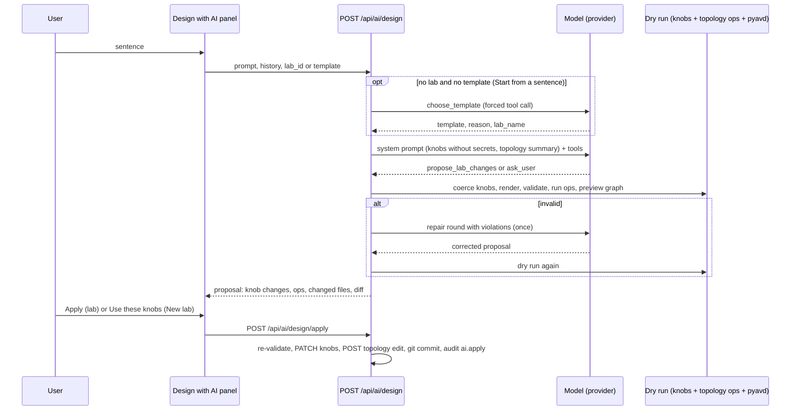
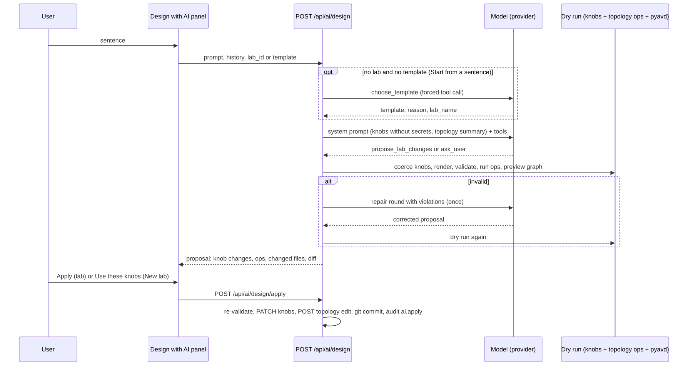

# 6. AI lab designer

The AI designer turns a sentence — *"3 spines, 4 leaf pairs with MLAG, 2 servers per pair, tenant ACME with VLANs
110/120, CloudVision cvaas"* — into a **proposal of validated AVD inputs** that you review before anything changes. It is
optional, bring-your-own-model, and follows the project's one rule: **the AVD inputs stay the source of truth and the
model never writes YAML**.

Where it appears:

| Entry point | Mode | What *apply* does |
|---|---|---|
| **Design with AI** button on the lab **Topology** and **Settings** tabs | lab mode: the model sees the lab's knobs and topology and may propose knob changes **and** topology operations | *Apply* changes the lab (git commits, audit event) |
| **Design with AI** in step 2 of **New lab** | template mode: the model sees the chosen template's knobs | *Use these knobs* fills the wizard's knob form; nothing is created until *Create lab* |
| **Start from a sentence** card in step 1 of **New lab** | from scratch: the model first picks the template, then proposes knobs | the wizard jumps to step 2 with the knobs filled, a suggested lab name and a note explaining the template choice |

## 6.1 How a design call works





1. **Resolve the model.** The user's own link (Account → AI assistant) wins; otherwise the admin's shared default is
   used if *Allow users without their own link to use this model* is on. No model → `409 {code: "no_ai_link"}` and the
   panel offers *Link a model on your Account page*.
2. **Rate limit.** 30 design calls per user per hour (`AVDLAB_AI_RATE_LIMIT`), counted in memory → `429`.
   *Start from a sentence* uses two model calls and counts twice.
3. **Choose a template** (from-scratch only). One forced `choose_template` tool call over the template catalogue (every
   template except `custom`: name, title, description, tags, node count, generator, notes, first knob keys); the tool
   description tells the model to prefer `single-dc-l3ls` for any generic spine/leaf or EVPN/VXLAN request. The answer
   carries the template, a one-sentence reason and a slug-like lab name. If the model does not call the tool with a
   known template, avdlab falls back to `single-dc-l3ls` (lab name `ai-lab`).
4. **Build the system prompt.** Fixed rules and AVD vocabulary, the template (name, title, generator, description,
   notes), every knob with type, range, help, the first pitfalls from its `learn` block and its **current value** —
   except secret knobs, which are listed as "secret: never set, never shown" — and, in lab mode, the current lab (name,
   state, target), the topology operations available, and a **topology summary** (hostnames → node type, connected
   endpoints with their switch ports, up to 16 free ports per leaf). Knob values longer than 4000 characters and the
   summary beyond 6000 characters are truncated.
5. **Call the model** with tool choice "must call a tool" and two tools (below). The conversation history (up to 40 turns)
   is cleaned: only user/assistant turns, consecutive same-role turns merged, each turn capped at 8000 characters.
6. **Dry run** the proposal through the same code paths as the Settings form and the topology editor: sanitise (secret or
   masked knobs dropped with a note, op shapes checked, at most 50 ops), coerce knobs, render the inputs, validate with
   pyavd, run the topology ops in order on a copy, rebuild the topology preview. The result: `valid`, `violations`,
   `changed_files`, unified `diff`, preview `graph`, knob changes (old → new), warnings.
7. **Repair round.** If the dry run fails, the violations (up to 40) are sent back to the model once, asking for a
   corrected complete proposal. The panel marks a repaired proposal ("the first proposal failed validation; the model
   fixed it"). A second failure is returned as an invalid proposal with its violations — never applied.
8. **Review.** The panel shows the summary, *Assumptions* (values the model chose itself, plus server notes), *Knob
   changes* (old → new), *Topology operations*, the changed files and the diff. You can *Refine* (send another message;
   the history is kept), *Discard*, or apply.
9. **Apply** (`POST /api/ai/design/apply`, lab mode). The proposal is sanitised and **dry-run again** (all or nothing:
   never half-applied); refused with 409 while `lab.build`, `lab.deploy` or `lab.destroy` runs for the lab. Knob changes go
   through `PATCH /api/labs/{id}`, topology ops through `POST /api/topology/{id}/edit` — so every change is a git commit of
   the lab exactly as if you had made it by hand — and an `ai.apply` event is written to the audit log. A built lab goes
   back to `draft`: press *Build*.

## 6.2 The tools the model may call

| Tool | Arguments | Notes |
|---|---|---|
| `propose_lab_changes` | `knobs` (partial knob values — JSON schema generated from the template descriptor: types, min/max, choices, help), `topology_ops` (lab mode only, ≤ 50), `summary`, `assumptions` | list/YAML knobs (`tenants`, `servers`, `dns_servers`) replace the whole value, so the model must include entries it wants to keep |
| `ask_user` | `question` | one clarifying question when an essential detail is missing and there is no sensible default |
| `choose_template` | `template` (enum of template names), `reason`, `lab_name` | only in the from-scratch step |

Topology operations (the ops of the topology editor, same argument shapes as `POST /api/topology/{id}/edit`):

| Op | Arguments | Available |
|---|---|---|
| `set_uplink` | node, index, switch, switch_port | all templates |
| `add_endpoint` | name, type (default `servers`), adapters | all templates |
| `update_endpoint` | name, adapters | all templates |
| `remove_endpoint` | name | all templates |
| `add_leaf_pair` / `remove_last_leaf_pair` | — | l3ls templates (`single-dc-l3ls`) |
| `set_l2leaf_per_pair` | n | l3ls templates |
| `set_spine_count` | n | l3ls templates |

For a custom lab (generator `none`) only topology ops can change it. In template mode (New lab) count ops are folded
into the knobs.

Rules the system prompt gives the model: never write YAML, CLI or files; nothing changes until the user presses Apply;
ask at most one question, otherwise propose and list every own choice in `assumptions`; only include knobs it changes;
never set secret knobs (tell the user to set them in Settings); answer in the user's language. It also carries AVD
vocabulary (node types, MLAG pairs sharing a VTEP, tenants → VRFs → SVIs with `ip_address_virtual` and `enabled: true`,
L2VNI = `mac_vrf_vni_base` + VLAN, how a dual-homed server is one adapter on both MLAG leafs with `port_channel: {mode:
active}`, CloudVision modes and the need for public DNS with CVaaS).

Local models without proper tool calling sometimes answer with the JSON as text; the server accepts a JSON object in the
text that looks like a `propose_lab_changes` / `ask_user` call. If the model answers only in prose, the panel shows the
text.

## 6.3 Providers

| Provider | Base URL | Model (example) | Key |
|---|---|---|---|
| Anthropic (Claude) | empty (`https://api.anthropic.com`) | `claude-sonnet-4-5` | Anthropic API key, header `x-api-key`, `anthropic-version: 2023-06-01` |
| OpenAI | empty (`https://api.openai.com/v1`) | `gpt-4o` | OpenAI API key (Bearer) |
| Ollama | `http://<host>:11434/v1` | `llama3.1`, `qwen2.5` | none |
| LM Studio | `http://<host>:1234/v1` | the loaded model | none |
| vLLM | `http://<host>:8000/v1` | the served model | optional |
| Azure OpenAI | `https://<resource>.openai.azure.com/openai/deployments/<deployment>` | the deployment's model | Azure key (header `api-key`; `api-version` query parameter added) |

Two client implementations, plain `httpx`, no SDKs: `anthropic` (Messages API, `POST {base}/v1/messages`) and `openai`
(Chat Completions, `POST {base}/chat/completions` with `tools`/`tool_choice`, temperature 0.2) which covers every
OpenAI-compatible server. Responses are limited to 4096 tokens; each request times out after `AVDLAB_AI_TIMEOUT` seconds
(180 in code). **Test connection** lists the provider's models (`GET /v1/models` or `/models`; Azure: a one-token
completion) and says whether the configured model is in the list; the model field then offers the listed models.

Ollama example (on the lab host or any machine the orchestrator can reach):

```bash
ollama pull qwen2.5:14b          # a model with tool calling; small models propose less reliably
OLLAMA_HOST=0.0.0.0 ollama serve # then Account → AI assistant → OpenAI-compatible, http://<host>:11434/v1, qwen2.5:14b
```

## 6.4 Configuration

| Where | Who | What |
|---|---|---|
| Account → AI assistant | operators, admins | own link: provider, base URL, model, API key (write-only, encrypted; empty field keeps the stored key, *Remove* deletes link and key), *Test connection* with the unsaved form values |
| Admin settings → AI assistant | admins | shared default provider / base URL / model / API key (secret `ai_default_api_key`), *Allow users without their own link to use this model*, *Test connection* |
| `.env` | installer | `AVDLAB_AI_DEFAULT_PROVIDER`, `AVDLAB_AI_DEFAULT_BASE_URL`, `AVDLAB_AI_DEFAULT_MODEL`, `AVDLAB_AI_DEFAULT_API_KEY`, `AVDLAB_AI_SHARED_ALLOWED` (false), `AVDLAB_AI_RATE_LIMIT` (30), `AVDLAB_AI_TIMEOUT` — defaults only, the admin page wins |

**Roles.** Design calls are `POST` requests, so viewers are refused (403); the Account card says so. Linking a model
is also a write. Operators and admins can design and apply.

## 6.5 Privacy

Each design call sends to the configured provider:

| Sent | Not sent |
|---|---|
| the template descriptor: knob keys, types, ranges, help, pitfalls | secret knobs (device password and any other `secret`-type knob) |
| the lab's current knob values without secret knobs | onboarding tokens, service-account tokens, NetBox tokens |
| a topology summary: hostnames, node types, endpoints, free switch ports | SSH keys, host addresses and credentials |
| lab name, state, target (lab mode) | job logs, running configs, ANTA results |
| your chat messages and the conversation history | the API key itself in any prompt (it is only a request header) |

API keys are only ever put in request headers and every provider error passes through a masking function, so a key
echoed by a provider or proxy never reaches a log line or an HTTP response (`502 {message}` carries the masked
provider error). When lab data must not leave your network, use a local model (Ollama, LM Studio, vLLM). When an admin
enables the shared model, every user's lab data is sent to that provider — the admin form says so.

## 6.6 Limits and behaviour to expect

| Limit | Value |
|---|---|
| prompt length | 8000 characters |
| history | 40 turns, 20000 characters each on input, 8000 used per turn |
| ops per proposal | 50 |
| design calls | 30 per user per hour (in memory; restarts reset it) |
| repair rounds | 1 |
| provider timeout | `AVDLAB_AI_TIMEOUT` (180 s in code; README and `.env.example` mention 120) |
| response size | 4096 tokens |
| typical duration | from a sentence: two model calls plus a pyavd dry run — "up to a minute" |

Errors you may see:

| Response | Meaning |
|---|---|
| `409 no_ai_link` | no own link and no shared model allowed |
| `429 AI design rate limit reached` | wait or raise `AVDLAB_AI_RATE_LIMIT` |
| `502 {message}` | the provider failed (bad key, unknown model, timeout, HTTP error); the message is the provider's, masked. Since 0.10.1 the panel shows this message instead of a bare "HTTP 502". |
| `422 invalid proposal` / `n violation(s)` on apply | the proposal no longer validates against the current lab (e.g. it changed since) — refine and try again |
| `409 lab.build is running for this lab` on apply | wait for the job |

Small local models propose less reliably (missing `enabled: true` on SVIs, wrong adapter shapes); the repair round fixes
many such cases, and nothing invalid is ever applied.
