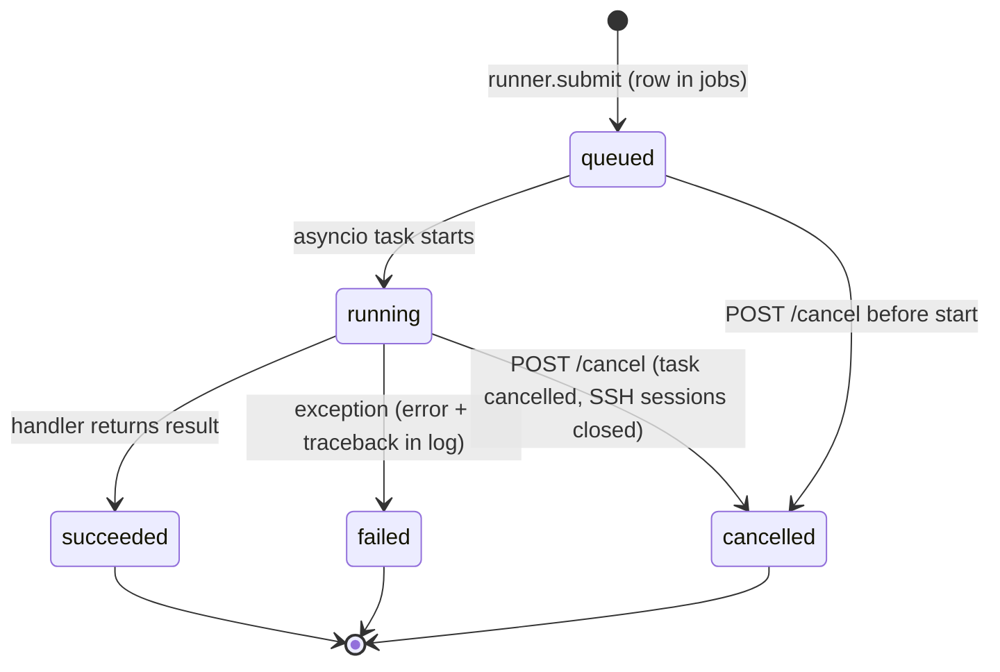

# 8. Operations

How to watch avdlab work, what to do when it does not, how to keep it current, and how releases are numbered.

## 8.1 Jobs and logs





| Where | What you get |
|---|---|
| Job drawer | opens on every action; live log over the WebSocket; *Kill* while running |
| Lab → Jobs tab | every job of the lab |
| `/jobs` (Advanced mode) and `/jobs/<id>` | all jobs; params, result, error, log |
| `/data/jobs/<id>/log.txt` | the raw log on disk (timestamps `[HH:MM:SS]`, UTC) |
| `docker compose logs -f api` | API process log: startup, update checks, AI calls (`ai design by …`), mail failures, uvicorn access log |
| `/data/update.log` | output of the self-update helper |
| lab repo `anta/runs/`, `anta/psirt/`, `snapshots/` | validation and PSIRT reports, show-command snapshots, all committed |

Reading a job log: lines are tagged by phase — `[ssh]` connection attempts and jump hops, `[skip]` / `[apply]` / `[ok]` /
`[FAIL]` recipe steps, `[hint]` probe recommendations, `[deploy]`, `[eapi]`, `[ztp]`, `[validate]`, `[push]`, `[cv]`,
`[sync]`. A failed job ends with `job failed: <error>` and the Python traceback; the job's `error` field (shown in the UI)
is the first line. Commands with secrets never show them: tokens are masked, credentials travel on stdin.

**Killing a job** cancels its task and closes its SSH sessions, so remote commands (a long `containerlab deploy`, an
ANTA run) stop with them. Containers already started stay — use *Destroy* or the host monitor to clean up.

**After an API restart** a job that was `queued` or `running` is not resumed and its row keeps its old status. Such a stale
row can make later actions on that lab answer 409 *"… is already running for this lab"*; *Kill* answers
`{"cancelled": false}` for it because the new process does not own it. See the matrix below for the workaround.

## 8.2 Troubleshooting matrix

Every row comes from a field problem fixed or explained in `CHANGELOG.md` (version in the last column) or from an error
message the code produces.

### Hosts and SSH

| Symptom / message | Cause | Fix | Ref |
|---|---|---|---|
| `TCP connect timed out — host unreachable from the app container …` (after 3 attempts) | host asleep/offline, firewall, or the API container's Docker network lost LAN access | wake/check the host; `docker compose restart api`; from Azure, check VPN/Tailscale or the lab host's NSG | 0.5.3 |
| `connection refused — sshd not listening on that port` | wrong port or sshd down (Mac/WSL: sshd not enabled in the VM) | fix the port; `systemctl enable --now ssh` in the VM | 0.5.3 |
| `authentication failed (…)` | wrong key/password; public key not in `authorized_keys`; for a jump host, the key is missing on one of the two hops | re-add the public key on the host (and on the jump host) | — |
| `host key mismatch … remove the host's line from <data>/known_hosts` | the host (or VM) was reinstalled or the address now points elsewhere | delete that line from `/data/known_hosts` in the volume, connect again | — |
| `sudo needs a password on this host …` / bootstrap fails at the first sudo step | no NOPASSWD and no sudo password on the host | add a sudo password in Edit host, or `echo "$USER ALL=(ALL) NOPASSWD:ALL" \| sudo tee /etc/sudoers.d/avdlab` | 0.1.1 |
| `unsupported or undetectable OS` / *macOS (not a lab host)* / *Windows (not a lab host)* | you added the Mac or the PC itself instead of its Linux VM | Address = the VM (`avdlab-vm.orb.local`, or `localhost` on Windows), Jump host = the Mac/PC; probe again | 1.0.1 |
| `[FAIL] <step>: apply rc=…` in a bootstrap | the step's apply command failed (no internet to `get.docker.com` / `containerlab.dev`, package mirror) | fix connectivity, re-run Bootstrap (steps already done are skipped) | — |
| `user cannot run docker` after bootstrap | group membership applies to new logins | nothing to do: avdlab uses sudo for Docker; re-probe later | — |
| `host <name> was never probed` / `lacks docker and containerlab` on deploy | deploy checks the stored capabilities | Probe, Bootstrap, Probe | — |

### Images

| Symptom / message | Cause | Fix | Ref |
|---|---|---|---|
| catalogue says arista.com rejected the request | mistyped or expired arista.com token | *Replace token* (Images header) — same secret, cache dropped — then *Retry* | 0.7.1 |
| catalogue 409 | no `arista_token` secret yet | *arista.com token…* → save | — |
| `image arista/ceos:<v> not on host <name> — push it from Images` | the image is neither on the host nor in the image store | download it (or upload), then Push or Deploy again | — |
| `host is x86_64, image is arm64 …` (or the reverse) | `ceos_arch` does not match the host CPU | set `ceos_arch` (image picker does it), rebuild | 0.4.0 |

### Deploy and runtime

| Symptom / message | Cause | Fix | Ref |
|---|---|---|---|
| deploy after a host crash failed with *Subnet 172.16.1.0/24 already in use by Docker network "clab-mgmt-<other lab>"* | a lab's management network survived without its containers | fixed: deploy removes empty leftover networks on its subnet automatically | 0.10.1 |
| `management subnet … is in use by the running lab '<x>' (n containers) on this host` | two labs with the same `mgmt_subnet` on one host | destroy the other lab, or change this lab's `mgmt_subnet` (e.g. `172.16.2.0/24`) and rebuild | 0.10.1 |
| `containerlab deploy failed (rc=…): <last lines>` | containerlab error (image, kernel, sysctl, port names) | read the job log above; check probe recommendations | — |
| nodes stay `eAPI ✗` / deploy ends with pending nodes | switches still booting, or the timeout is too short for a big fabric | Runtime → raise *timeout*, *Refresh*; check host RAM (2 GB per node) | — |
| a page refresh or direct link answered `{"detail": "Not Found"}` | the SPA fallback did not cover deep links | fixed: every non-API path that is not a file serves `index.html` | 0.10.1 |
| the lab page went blank after a failed CloudVision deploy | a panel assumed a workspace existed and crashed the SPA | fixed: null-safe panel and error boundaries on every page and tab | 0.8.0 |
| test-host add/remove failed with an ansible *No route to host* buried under warnings | the lab's switches were not actually running (host rebooted) although the lab said deployed | fixed: a pre-check names the switch that is down and suggests *Redeploy*; remove completes with a warning | 0.10.1 |
| test-host / ACT deploy failed with `Could not find or access '/proc/1/fd/pipe:[N]'` | Ansible cannot read `-e @/dev/stdin` | fixed: credentials still on stdin, copied to a 0600 file inside the throw-away agent container | 0.7.2 |
| hot-added test host: `interface_visible: false` warning | a hot-added port is not in the `EosIntfMapping.json` the switch booted with | full *Redeploy* (the port is then mapped) | 0.7.0 |
| `… is already running for this lab` (409) but nothing runs | stale job row after an API restart (8.1) | with SQLite: `docker compose stop api`, then `docker run --rm -v avdlab_avdlab-data:/data alpine sh -c "apk add -q sqlite && sqlite3 /data/avdlab.db \"UPDATE jobs SET status='failed' WHERE status IN ('queued','running')\""`, then `docker compose start api` | — |
| Push config changes shows every device as *not tracked yet* | the lab was deployed before incremental push existed | push them all once; afterwards only changed ones are listed | 0.10.1 |

### Validation and PSIRT

| Symptom / message | Cause | Fix | Ref |
|---|---|---|---|
| `agent image … lacks ANTA >= …` | `AVDLAB_AGENT_IMAGE` points at an image with an old ANTA | use the default universal image or build `agent/` (ANTA 1.10) and set `AVDLAB_AGENT_IMAGE`; re-run Verify | — |
| `no ANTA JSON report produced (ansible-playbook rc=…)` | the playbook failed before ANTA wrote a report | read the ansible output in the log (inventory, credentials, reachability) | — |
| advisory scan: every `show running-config` based check errored | `anta psirt` ran without privileged mode | fixed: runs with `--enable` and the dedicated ANTA 1.10 image (`AVDLAB_ANTA_IMAGE`) | 0.10.1 |
| advisory scan: image pull slow on first run | the ANTA image is pulled on the lab host on first use | wait, or pre-pull `ghcr.io/aristanetworks/anta:1.10.0` | 0.10.1 |

### CloudVision

| Symptom / message | Cause | Fix | Ref |
|---|---|---|---|
| `CloudVision pre-flight failed …: service-account token rejected` | expired / wrong service-account token | generate a new one (CloudVision Settings → Access Control → Service Accounts), save it on the target | 0.8.0 |
| `pre-flight failed … could not reach the CloudVision API on 443` | DNS / firewall / proxy from the orchestrator, or `verify_certs` with a private CA | fix reachability or untick verify certificates on the target | 0.8.0 |
| *Workspace submitted, nothing to push* | designed config = running config (the fabric was deployed with the same intended configs), so CloudVision creates no change control | expected; change a knob, build, deploy to CloudVision again to see a change control | 0.7.1, 0.8.0 |
| change control stays *pending approval* | *approve & execute the change control* was unchecked | approve and run it in CloudVision, or tick the option | 0.10.1 |
| CVaaS region dropdown offered `eu-west-2` and the build failed validation | names AVD does not know | fixed: the list equals AVD 6.4's valid values (`euwest-2`, `us-4`, `apnortheast-1`, …) | 0.10.1 |
| onboarding: nodes not streaming, token file missing | the cEOS tmpfs on `/tmp` hid files copied with `docker cp` | fixed: token written inside the container via `docker exec -i`, copy on flash | 0.5.2 |
| onboarding: TerminAttr not restarting | single-step restart raced | fixed: two-step restart with a PID check, token verification, newest-log diagnostics | 0.5.1 |
| onboarding: TerminAttr state misread | check ran without privilege 15 | fixed: privilege-15 checks, strict config parse, `show daemon` + log tail in the job log | 0.4.1 |
| switches cannot resolve the CVaaS name | lab DNS points at a private resolver | set `dns_servers` to public resolvers (1.1.1.1, 8.8.8.8), rebuild, push/redeploy | — |
| `set the cloudvision knob to cvaas or onprem before binding a CloudVision target` (409) | the target is bound while mode is `none` | set the knob first (Settings does it in the right order) | — |
| a cleared target token was still used | null did not remove the secret | fixed | 0.3.0 |

### NetBox

| Symptom / message | Cause | Fix | Ref |
|---|---|---|---|
| `Invalid authorization header` with a NetBox 4.5+ token | v2 tokens `nbt_<id>.<secret>` must be sent as `Bearer` | fixed: pynetbox ≥ 7.8 pinned + header override; a pasted `Token `/`Bearer ` prefix is stripped; the connection test explains both formats | 0.10.1 |
| tokens saved before 0.10.0 fail | stored with a `Token ` prefix or whitespace | fixed: normalised on read | 0.10.1 |
| devices of two labs collide | the NetBox site is the AVD `dc_name` (else the fabric name) | give each lab its own `dc_name` / fabric name, or its own NetBox | — |
| `lab is draft: build it before syncing to NetBox` | the sync reads build outputs | Build first | — |

### AI designer, accounts, mail

| Symptom / message | Cause | Fix | Ref |
|---|---|---|---|
| AI panel showed a bare `HTTP 502` | the client dropped the server's message | fixed: the provider's (masked) error is shown | 0.10.1 |
| `502 …: timeout after N s` | slow model with tool use | larger `AVDLAB_AI_TIMEOUT`, a faster model | — |
| `409 no AI model linked` | no own link, no shared model allowed | Account → AI assistant, or ask an admin to allow the shared model | 0.10.0 |
| `429 AI design rate limit reached` | 30 calls per hour per user | wait or raise `AVDLAB_AI_RATE_LIMIT` | 0.10.0 |
| signed in over `http://…:8080` but bounced back to the login page | the session cookie is `Secure` (public URL is https) | use the https URL | 0.8.0 |
| account locked | 5 wrong passwords | wait 15 minutes, or an admin *Unlock*s | 0.8.0 |
| lost phone and recovery codes | MFA | an admin *Reset MFA* | 0.8.0 |
| lost the only admin password | — | stop, `sqlite3 /data/avdlab.db "DELETE FROM users"` (removes all accounts), start: admin re-created from env | 0.8.0 |
| no e-mails | SMTP host empty, or the server refuses | Admin settings → *Send test mail* shows the SMTP error; failures are only logged, never block requests | 0.9.0 |
| viewer cannot send feedback | `POST /api/feedback` is a write; viewers are read-only | use the *E-mail* button in the feedback form, or give the user operator | — |
| Save buttons hidden behind the Feedback button | layout | fixed: sticky save bars at the top-left | 0.10.1 |

### Installation and updates

| Symptom / message | Cause | Fix | Ref |
|---|---|---|---|
| TypeScript build fails after unpacking a tarball (`name 2.ts`) | Finder unpacked next to the folder | extract with `tar -xzf … -C ~`, or delete `* [0-9].*` files (chapter 3) | — |
| Update panel: `docker socket … is not mounted` | self-update needs the socket | uncomment the `docker.sock` volume | 0.7.0 |
| `AVDLAB_DEPLOY_DIR is not set` / `must be an absolute host path` | compose not run from `deploy/`, or `-f` from elsewhere | run compose from `deploy/` or set it explicitly | 0.7.0 |
| `409` on Update now | a job is running, or no newer release is known | wait / *Check now*; `force` re-applies | 0.7.0 |
| the new version did not answer in time | the helper failed (git conflicts, build error) | read `/data/update.log` | 0.7.0 |
| Caddy: no certificate | DNS A record missing/late, port 80 closed, rate limit | create DNS first, open 80/443, use `AVDLAB_ACME_STAGING=true` while testing | 0.8.0 |

## 8.3 Monitoring

| What | How |
|---|---|
| API health | Docker healthcheck (`curl http://127.0.0.1:8080/api/auth/me` → 200 or 401) every 30 s; `docker compose ps` |
| Lab hosts | Dashboard *Lab hosts* panel (CPU, memory, disk, containers per host, every 30 s); host Monitor page (charts, processes, containers); 7 days in `host_metrics` |
| Lab status | Runtime tab (inline inspect + eAPI probe); `lab.status` as a job |
| Certificates | `docker compose --profile public logs caddy`; Caddy renews ~30 days before expiry |
| Sign-ins and account changes | Users → Audit log (`GET /api/users/audit?limit=…`) |
| Problems reported by users | `/feedback` (with diagnostics), optional GitHub issues and mail |
| Updates | version badge pill; Update panel; `GET /api/meta/update` |

The monitor samples only hosts with a deployed lab or viewed in the last 10 minutes, one SSH session per host, and never
raises out of its loop (a failing host is logged and retried on the next tick). Disable it with
`AVDLAB_MONITOR_ENABLED=false` if background SSH is not wanted.

## 8.4 Updating

Chapter 3 §3.3 has the three paths (tarball, git, in-app). Operational rules:

- Update when no job runs (the in-app update refuses otherwise). Running labs are not touched: containers on lab hosts
  keep running across an orchestrator update.
- Back up the `avdlab-data` volume first (chapter 3 §3.4).
- The database schema is migrated automatically at startup (new tables, added columns).
- After the update, check *About* (version, git sha, build date) and `GET /api/meta`.

## 8.5 Versioning and releases

avdlab follows [Semantic Versioning](https://semver.org/) and keeps a [Keep a Changelog](https://keepachangelog.com/)
`CHANGELOG.md`. **House rule since 0.10.1: every fix that ships gets its own patch version**, so the sidebar badge and
`GET /api/meta` say exactly what is deployed.

The version lives in three files kept in sync by the release script: `VERSION`, `backend/pyproject.toml`,
`frontend/package.json`.

`scripts/release.py`:

```bash
scripts/release.py patch                 # 1.0.1 -> 1.0.2
scripts/release.py minor                 # 1.0.2 -> 1.1.0
scripts/release.py major                 # -> 2.0.0
scripts/release.py 1.2.3                 # explicit
scripts/release.py patch --tar <dir>     # also writes <dir>/avdlab-v<version>.tar.gz
scripts/release.py patch --no-commit     # only bump files and changelog
scripts/release.py patch -m "extra line" # extra commit message line
```

| Step | What it does |
|---|---|
| bump | computes the new version from `VERSION` |
| write versions | `VERSION`, `version = "…"` in `pyproject.toml`, `"version"` in `package.json` |
| roll changelog | renames `## [Unreleased]` to `## [<version>] - <today>`; without an Unreleased section it inserts a stub `### Fixed - (describe the fix)` |
| commit + tag | `git add -A`, commit `release <version>`, `git tag -f v<version>` (the tag is moved if it exists) |
| tarball | `avdlab/` tree without `node_modules`, `dist`, `__pycache__`, `.pytest_cache`, `.venv`, `.git`, `*.pyc` |

Work in progress goes under `## [Unreleased]` in `CHANGELOG.md`; the script renames it.

**GitHub workflows.** `ci.yml` runs on every push and pull request (not on `v*` tags): backend `pytest`, frontend
`npm test` + `npm run build`, and an image build without push. `release.yml` runs on a pushed tag `v<version>`: both test
suites, a check that the tag equals `VERSION`, the multi-arch image (amd64 + arm64) pushed as
`ghcr.io/<owner>/avdlab:<version>` and `:latest`, and a GitHub Release with the source tarball and the matching CHANGELOG
section as notes. A GitHub release is what `AVDLAB_UPDATE_SOURCE=github:<owner>/<repo>` finds.
